# Assignment 04 — Deploy Mini Finance on Azure Using Terraform and Ansible

Part of the DevOps Micro Internship (DMI) with Agentic AI

---

## Purpose

In this assignment, you will provision Azure infrastructure using Terraform and deploy the Mini Finance website using an Ansible multi-play playbook.

Terraform will create the Azure Virtual Machine and networking resources. Ansible will install Nginx, clone the Mini Finance repository, deploy the website, and verify the deployment.

---

# Task 1 — Create the Project Structure

## Goal

Create separate directories and files for the Terraform infrastructure and Ansible configuration.

### Evidence

#### Screenshot 1 — Terminal or VS Code showing the complete `mini-finance` project structure

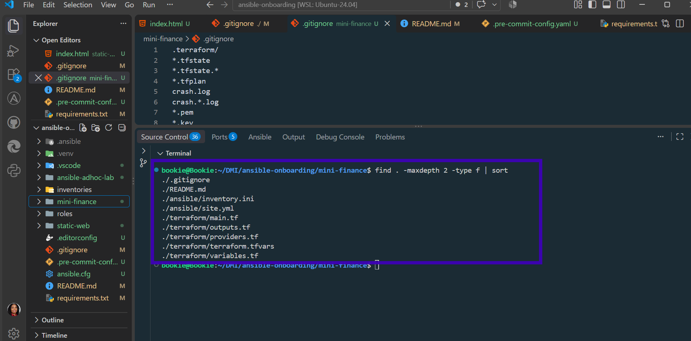

---

### Notes

#### Project File Structure

The `mini-finance` project is organized into separate Terraform and Ansible directories to clearly distinguish infrastructure provisioning from server configuration and application deployment.

* **`terraform/`** – Contains the Terraform configuration used to provision the secure Azure VM and its supporting infrastructure.

  * `providers.tf` – Defines Terraform and Azure provider requirements.
  * `variables.tf` – Defines configurable Terraform variables.
  * `terraform.tfvars` – Provides values for the defined variables.
  * `main.tf` – Defines the Azure infrastructure resources.
  * `outputs.tf` – Displays useful information from the deployment, such as the VM public IP.

* **`ansible/`** – Contains the Ansible configuration used to configure the Azure VM and deploy the Mini Finance application.

  * `inventory.ini` – Defines the Azure VM as an Ansible managed host.
  * `site.yml` – Contains the Ansible plays and tasks for installing Nginx, deploying the Mini Finance website, and verifying the deployment.
  * `files/` – Stores files required for the Mini Finance website deployment.

* **`README.md`** – Documents the project objective, implementation steps, configuration, testing, and results.

* **`.gitignore`** – Prevents sensitive files and unnecessary generated files from being committed to version control.

This structure follows a clear **Infrastructure as Code (Terraform) → Configuration Management (Ansible) → Application Deployment (Mini Finance)** workflow.

---

# Task 2 — Create the Azure Infrastructure Using Terraform

## Goal

Use Terraform to provision an Ubuntu Virtual Machine with the required Azure networking and security resources.

### Evidence

#### Screenshot 2 — Terraform code showing the `Allow-SSH` rule for port `22` and the `Allow-HTTP` rule for port `80`

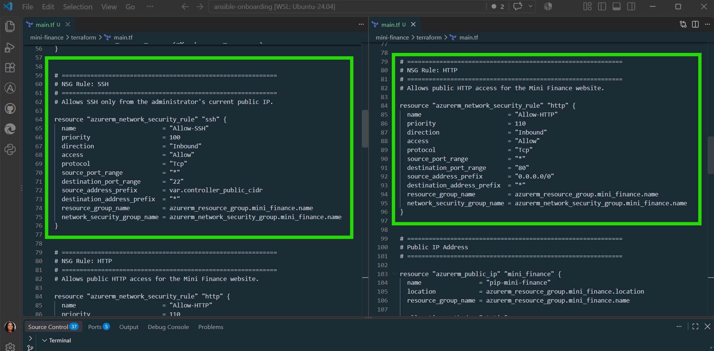

---

#### Screenshot 3 — Terraform code showing the association between `nsg-mini-finance` and `nic-mini-finance`

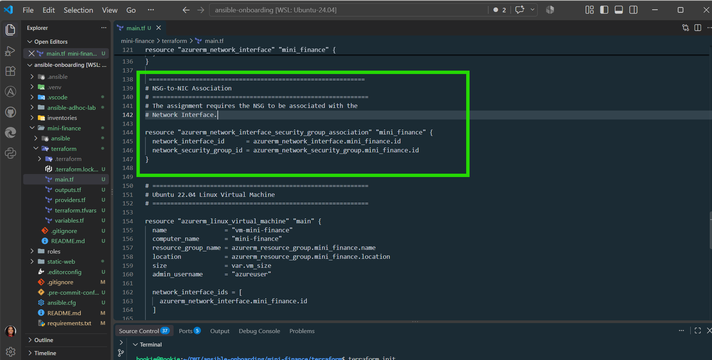

---

### Notes

### 1. Assignment Objective

The objective of this assignment was to use **Terraform** to provision a secure Azure environment for hosting the **Mini Finance website**.

The infrastructure includes:

* An Azure Resource Group
* A Virtual Network (VNet)
* A Subnet
* A Network Security Group (NSG)
* SSH and HTTP security rules
* A Static Public IP
* A Network Interface (NIC)
* An NSG-to-NIC association
* An Ubuntu 22.04 Linux Virtual Machine
* A Terraform output for the VM's public IP address

Terraform was used so that the infrastructure could be created consistently through code instead of manually creating each resource through the Azure Portal.

---

## 2. Azure Infrastructure Created

The infrastructure follows this basic network structure:

**Virtual Network → Subnet → NIC → Virtual Machine**

The NSG is attached directly to the NIC:

**NSG → NIC → VM**

### Resource Group

The Resource Group is:

```text
rg-mini-finance
```

It provides a logical container for all the Azure resources used by the Mini Finance project.

### Virtual Network

The VNet is:

```text
vnet-mini-finance
```

with the address space:

```text
10.0.0.0/16
```

The VNet provides the private network in which the VM operates.

### Subnet

The subnet is:

```text
subnet-mini-finance
```

with the address range:

```text
10.0.1.0/24
```

The subnet is a smaller network inside the VNet where the VM's network interface is connected.

---

## 3. Network Security Group

The NSG is:

```text
nsg-mini-finance
```

An NSG acts like a firewall by controlling which network traffic is allowed to reach the VM.

Two inbound rules were configured.

### Allow-SSH

```text
Name: Allow-SSH
Protocol: TCP
Port: 22
Source: Controller public IP /32
Access: Allow
```

SSH access is restricted to the current public IP address of the administrator.

The `/32` means that only **one specific IPv4 address** is allowed.

This is more secure than allowing SSH from:

```text
0.0.0.0/0
```

because `0.0.0.0/0` would allow SSH attempts from anywhere on the Internet.

### Allow-HTTP

```text
Name: Allow-HTTP
Protocol: TCP
Port: 80
Source: 0.0.0.0/0
Access: Allow
```

HTTP traffic is allowed from the Internet because the Mini Finance website needs to be accessible through a web browser.

---

## 4. Static Public IP

The VM was assigned a Standard Static Public IP:

```text
pip-mini-finance
```

The IP uses:

```text
Allocation: Static
SKU: Standard
```

A static public IP provides a consistent public address that can be used to connect to the VM through SSH and access the website over HTTP.

---

## 5. Network Interface

The network interface is:

```text
nic-mini-finance
```

Its IP configuration is:

```text
ipconfig-mini-finance
```

The NIC is connected to:

```text
subnet-mini-finance
```

and the static public IP:

```text
pip-mini-finance
```

The private IP allocation is dynamic.

The NIC provides the network connection between the Azure VM and the Azure network.

---

## 6. NSG-to-NIC Association

A key requirement of this assignment was to associate the NSG directly with the **Network Interface**.

The Terraform resource used was:

```hcl
resource "azurerm_network_interface_security_group_association" "mini_finance" {
  network_interface_id      = azurerm_network_interface.mini_finance.id
  network_security_group_id = azurerm_network_security_group.mini_finance.id
}
```

This is different from the previous assignment, where the NSG was associated with the subnet.

### Why this matters

The NIC represents the VM's network connection, so attaching the NSG to the NIC allows the security rules to be applied directly to the VM's network interface.

The simplified structure is:

```text
Internet
   |
   | HTTP :80
   | SSH  :22 from trusted IP
   |
   v
[ NSG ]
   |
   v
[ NIC ]
   |
   v
[ VM ]
```

---

## 7. Ubuntu Linux Virtual Machine

The VM created was:

```text
vm-mini-finance
```

The computer/hostname is:

```text
mini-finance
```

The VM runs:

```text
Ubuntu Server 22.04 LTS
```

The administrator username is:

```text
azureuser
```

The VM uses the:

```text
Standard_D2ads_v7
```

size.

SSH public-key authentication was configured using:

```text
~/.ssh/id_ed25519.pub
```

Password authentication was disabled.

This means the VM is accessed using an SSH private/public key pair rather than a password.

---

## 8. Terraform Variables

Important configuration values were kept in variables rather than being hard-coded throughout the configuration.

Examples include:

```text
resource_group_name
location
vm_size
admin_username
controller_public_cidr
ssh_public_key_path
```

The `controller_public_cidr` variable contains the administrator's current public IP in `/32` CIDR notation.

For example:

```text
YOUR_PUBLIC_IP/32
```

The actual IP address should remain private and should not be committed to a public repository.

---

# Task 3 — Initialize and Apply the Terraform Configuration

## Goal

Format and validate the Terraform configuration, review the execution plan, and provision the Azure infrastructure.

### Evidence

#### Screenshot 4 — End of the `terraform apply` output showing `Apply complete!` with no errors

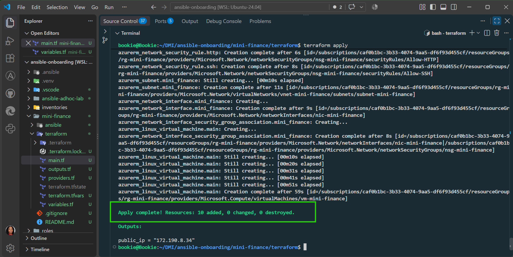

---

#### Screenshot 5 — Output of `terraform output public_ip` showing the VM’s public IP address

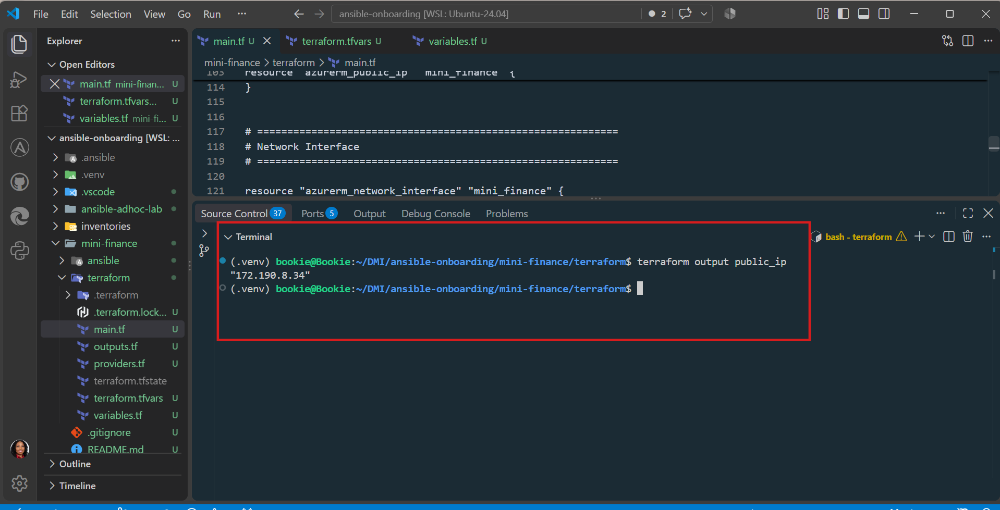

---

### Notes

## 9. Terraform Output

The VM's public IP was exposed through a Terraform output:

```hcl
output "public_ip" {
  description = "Public IP address of the Mini Finance VM"
  value       = azurerm_linux_virtual_machine.main.public_ip_address
}
```

This allows the public IP to be retrieved easily after deployment with:

```bash
terraform output public_ip
```

---

The next stage is to use **Ansible** to connect to the provisioned VM, install Nginx, deploy the Mini Finance website, and verify that the website is accessible through the VM's public IP.

---

## 14. Useful Commands

```bash
# Format
terraform fmt

# Initialize
terraform init

# Validate
terraform validate

# Preview changes
terraform plan

# Create infrastructure
terraform apply

# Display VM public IP
terraform output public_ip

# Show Terraform-managed resources
terraform state list

# Destroy the lab when finished
terraform destroy
```

### Important

After completing testing, `terraform destroy` can be used to remove the Azure resources and avoid unnecessary cloud costs.

---

# Task 4 — Verify Passwordless SSH Access

## Goal

Confirm that the Ansible controller can connect to the Terraform-provisioned Azure VM using SSH key authentication.

### Evidence

#### Screenshot 6 — Passwordless SSH command and the returned `mini-finance` hostname

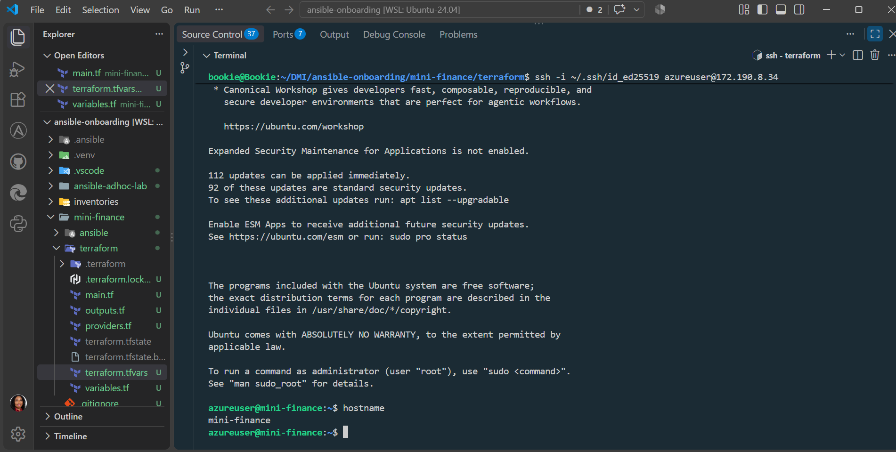

---

### Notes

### Task 5 — Verify Passwordless SSH Access

## Task 4 — Verify Passwordless SSH Access

**Goal:** Confirm that the Ansible controller can connect to the Terraform-provisioned Azure VM using SSH key authentication without a password.

### Steps

1. Retrieved the VM public IP using Terraform.
2. Connected to the VM using the SSH private key `~/.ssh/id_ed25519`.
3. Verified that the VM returned the expected hostname.
4. Confirmed that SSH did not request a password for `azureuser`.

### Commands

```bash
cd ~/ansible-onboarding/mini-finance/terraform
terraform output public_ip
```

Test SSH:

```bash
ssh -i ~/.ssh/id_ed25519 azureuser@<PUBLIC_IP> "hostname"
```

### Expected Output

```text
mini-finance
```

### Result

✅ Passwordless SSH access was successfully verified. The Ansible controller connected to the Azure VM using SSH key authentication, and no password was required.

# Task 5 — Create the Ansible Inventory and Verify Connectivity

## Goal

Add the Terraform-provisioned Azure VM to the Ansible inventory and confirm that Ansible can connect to it.

### Evidence

#### Screenshot 7 — Ansible ping output showing `SUCCESS` and `pong` from the Azure VM

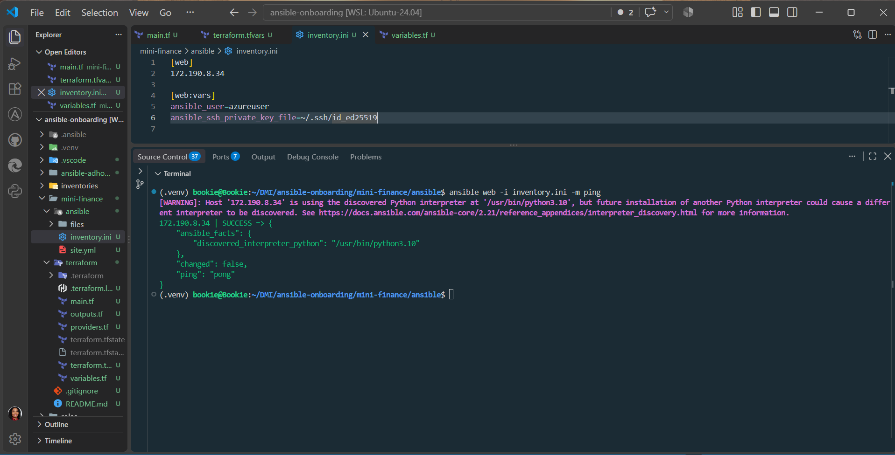

---

### Configuration File

Copy and paste the complete contents of your `ansible/inventory.ini` file below:

```ini
[web]
172.190.8.34

[web:vars]
ansible_user=azureuser
ansible_ssh_private_key_file=~/.ssh/id_ed25519
```

---

# Task 6 — Create the Multi-Play Ansible Playbook

## Goal

Create one Ansible playbook containing separate plays to install Nginx, deploy the Mini Finance website, and verify the deployment.

### Evidence

#### Screenshot 8 — `site.yml` showing Play 1 and the beginning of Play 2

Screenshot must show:

* Play 1 targeting the `web` group
* Installation of `nginx`, `git`, and `rsync`
* Nginx service configured as started and enabled
* Beginning of Play 2 with the Git repository URL and synchronization task

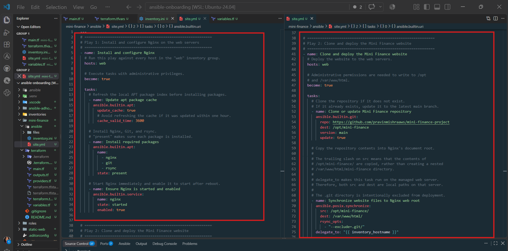

---

#### Screenshot 9 — `site.yml` showing the deployment destination, handler, and Play 3 verification

Screenshot must show:

* Website destination `/var/www/html/`
* Ownership set to `www-data:www-data`
* Nginx reload handler
* Play 3 targeting `localhost`
* The `uri` verification and `assert` condition

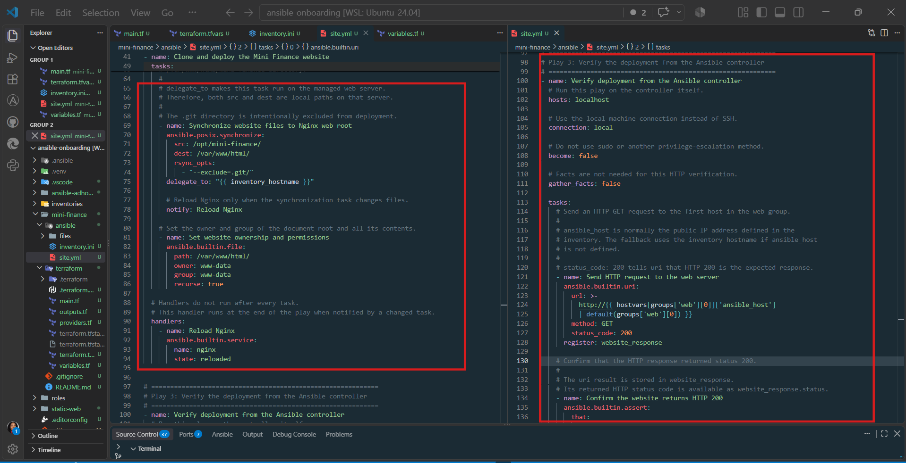

---

### Configuration File

Copy and paste the complete contents of your `ansible/site.yml` file below:

```yaml
---
# ============================================================
# Play 1: Install and configure Nginx on the web servers
# ============================================================
- name: Install and configure Nginx
  # Run this play against every host in the "web" inventory group.
  hosts: web

  # Execute tasks with administrative privileges.
  become: true

  tasks:
    # Refresh the local APT package index before installing packages.
    - name: Update apt package cache
      ansible.builtin.apt:
        update_cache: true
        # Avoid refreshing the cache if it was updated within one hour.
        cache_valid_time: 3600

    # Install Nginx, Git, and rsync.
    # "present" makes sure each package is installed.
    - name: Install required packages
      ansible.builtin.apt:
        name:
          - nginx
          - git
          - rsync
        state: present

    # Start Nginx immediately and enable it to start after reboot.
    - name: Ensure Nginx is started and enabled
      ansible.builtin.service:
        name: nginx
        state: started
        enabled: true


# ============================================================
# Play 2: Clone and deploy the Mini Finance website
# ============================================================
- name: Clone and deploy the Mini Finance website
  # Deploy the website to the web servers.
  hosts: web

  # Administrative permissions are needed to write to /opt
  # and /var/www/html.
  become: true

  tasks:
    # Clone the repository if it does not exist.
    # If it already exists, update it to the latest main branch.
    - name: Clone or update Mini Finance repository
      ansible.builtin.git:
        repo: https://github.com/pravinmishraaws/mini-finance-project
        dest: /opt/mini-finance
        version: main
        update: true

    # Copy the repository contents into Nginx's document root.
    #
    # The trailing slash on src means that the contents of
    # /opt/mini-finance/ are copied, rather than creating a nested
    # /var/www/html/mini-finance directory.
    #
    # delegate_to makes this task run on the managed web server.
    # Therefore, both src and dest are local paths on that server.
    #
    # The .git directory is intentionally excluded from deployment.
    - name: Synchronize website files to Nginx web root
      ansible.posix.synchronize:
        src: /opt/mini-finance/
        dest: /var/www/html/
        rsync_opts:
          - "--exclude=.git/"
      delegate_to: "{{ inventory_hostname }}"

      # Reload Nginx only when the synchronization task changes files.
      notify: Reload Nginx

    # Set the owner and group of the document root and all its contents.
    - name: Set website ownership and permissions
      ansible.builtin.file:
        path: /var/www/html/
        owner: www-data
        group: www-data
        recurse: true

  # Handlers do not run after every task.
  # This handler runs at the end of the play when notified by a changed task.
  handlers:
    - name: Reload Nginx
      ansible.builtin.service:
        name: nginx
        state: reloaded


# ============================================================
# Play 3: Verify the deployment from the Ansible controller
# ============================================================
- name: Verify deployment from the Ansible controller
  # Run this play on the controller itself.
  hosts: localhost

  # Use the local machine connection instead of SSH.
  connection: local

  # Do not use sudo or another privilege-escalation method.
  become: false

  # Facts are not needed for this HTTP verification.
  gather_facts: false

  tasks:
    # Send an HTTP GET request to the first host in the web group.
    #
    # ansible_host is normally the public IP address defined in the
    # inventory. The fallback uses the inventory hostname if ansible_host
    # is not defined.
    #
    # status_code: 200 tells uri that HTTP 200 is the expected response.
    - name: Send HTTP request to the web server
      ansible.builtin.uri:
        url: >-
          http://{{ hostvars[groups['web'][0]]['ansible_host']
          | default(groups['web'][0]) }}
        method: GET
        status_code: 200
      register: website_response

    # Confirm that the HTTP response returned status 200.
    #
    # The uri result is stored in website_response.
    # Its returned HTTP status code is available as website_response.status.
    - name: Confirm the website returns HTTP 200
      ansible.builtin.assert:
        that:
          - website_response.status == 200
        success_msg: "Mini Finance website is accessible."
        fail_msg: "Mini Finance website verification failed."

```

---

# Task 7 — Validate and Run the Ansible Playbook

## Goal

Validate the syntax of the multi-play Ansible playbook and run it to install Nginx, deploy the Mini Finance website, and verify the deployment.

### Evidence

#### Screenshot 10 — Successful playbook syntax check showing `playbook: site.yml`

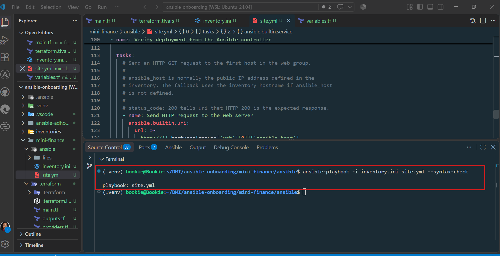

---

#### Screenshot 11 — Play 3 output showing the successful HTTP verification and assertion

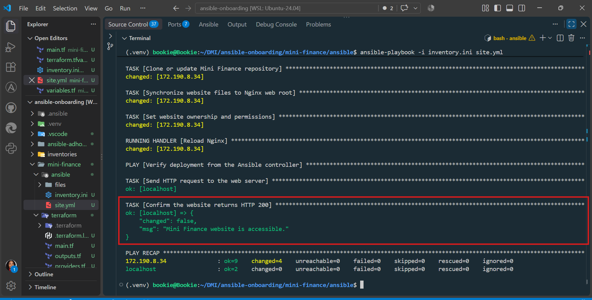

---

#### Screenshot 12 — Final `PLAY RECAP` showing `failed=0` and `unreachable=0`

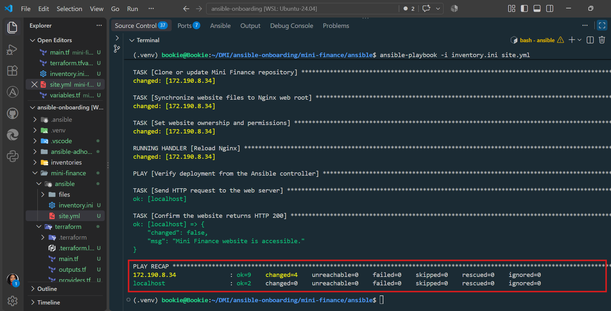

---

### Notes

## Task 6 & 7 — Create, Validate and Run the Ansible Playbook

Created `site.yml` with three plays to automate the Mini Finance deployment:

1. **Install and configure Nginx**

   * Updated the APT cache.
   * Installed `nginx`, `git`, and `rsync`.
   * Started and enabled Nginx.

2. **Clone and deploy Mini Finance**

   * Cloned the Mini Finance GitHub repository.
   * Synchronized the website files to `/var/www/html/`.
   * Excluded the `.git` directory.
   * Set ownership to `www-data:www-data`.
   * Added a handler to reload Nginx when website files changed.

3. **Verify the deployment**

   * Used the `uri` module from the Ansible controller to access the VM.
   * Used `assert` to confirm that the website returned HTTP status `200`.

The playbook was first validated with:

```bash
ansible-playbook -i inventory.ini site.yml --syntax-check
```

It was then executed with:

```bash
ansible-playbook -i inventory.ini site.yml
```

### Expected Result

```text
failed=0
unreachable=0
```

This confirms that the Ansible playbook successfully configured Nginx, deployed the Mini Finance website, and verified the web server response. ✅

---

# Task 8 — Test the Mini Finance Website in a Browser

## Goal

Confirm that the Mini Finance website is publicly accessible through the Azure VM’s public IP address.

### Evidence

#### Screenshot 13 — Mini Finance website successfully loading in the browser, with the Azure VM’s public IP address visible in the address bar

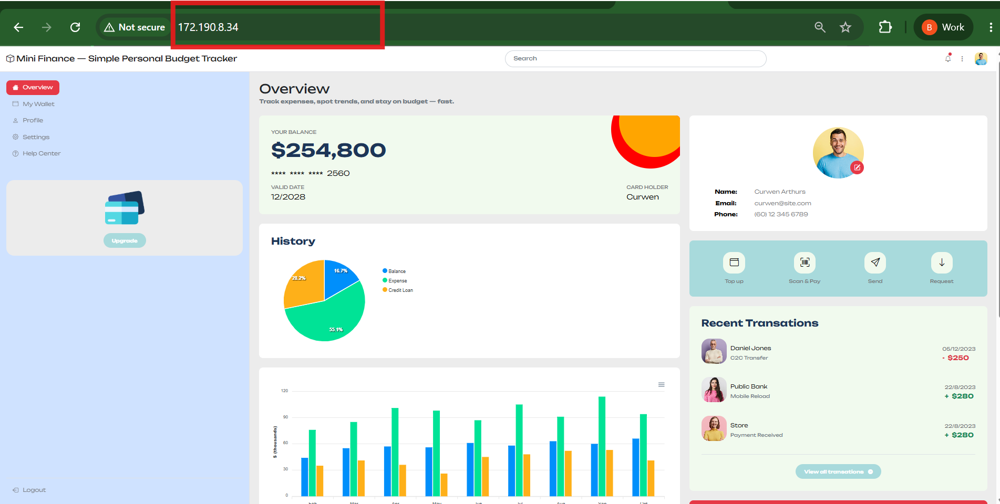

---

### Website URL

Add your deployed website URL below:

```text
http://172.190.8.34
```

---

# Task 9 — Create the Project README

## Goal

Create a `README.md` file to document the Mini Finance infrastructure and deployment project.

### Evidence

#### Screenshot 14 — Completed `README.md` displayed in the VS Code Markdown preview or terminal

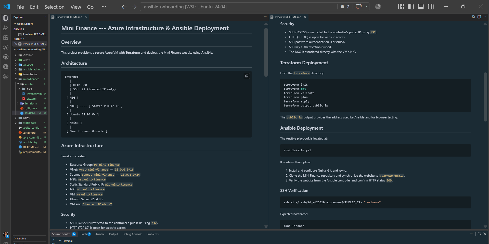

---

### README Content

Copy and paste the complete contents of your `README.md` file below:

```markdown
# Ansible Development Workstation — DMI Cohort 3 Week 09

## Project Title

**Ansible Development Workstation Setup**

## Completed By

**Adebukunola Oyetimehin**

---

## Project Objective

The objective of this project is to prepare an isolated, reusable, and team-friendly **Ansible development workstation** that will be used as the Ansible controller for upcoming assignments.

The workstation provides:

* A WSL2 Ubuntu development environment
* An isolated Python virtual environment
* Ansible and supporting linting tools
* VS Code integration
* SSH access configuration
* Git and pre-commit validation
* Reusable project configuration
* Documentation for setting up the same environment on another machine

The setup is designed to reduce configuration differences between developers and provide a consistent foundation for future Ansible automation work.

---

# 1. Controller Environment

| Component          | Configuration              |
| ------------------ | -------------------------- |
| Host OS            | Windows                    |
| Linux Environment  | WSL2                       |
| Linux Distribution | Ubuntu 24.04.5 LTS         |
| Python             | 3.12.3                     |
| Project Location   | `~/DMI/ansible-onboarding` |
| Python Environment | `.venv`                    |
| Git Branch         | `main`                     |
| Ansible Controller | WSL2 Ubuntu environment    |

The Ansible controller runs inside **Ubuntu on WSL2**, rather than directly on Windows.

This provides a Linux-based environment suitable for Ansible development while allowing the workstation to remain integrated with the Windows host.

---

# 2. Installed Tools

The following tools have been installed and verified.

| Tool         | Version |
| ------------ | ------- |
| Python       | 3.12.3  |
| Ansible Core | 2.21.4  |
| Ansible Lint | 26.8.0  |
| yamllint     | 1.38.0  |
| pre-commit   | 4.6.2   |
| Git          | 2.43.0  |
| OpenSSH      | 9.6p1   |
| OpenSSL      | 3.0.13  |

The main Python tools are installed inside the project's `.venv` environment.

Verified executable locations include:

```text
/home/bookie/DMI/ansible-onboarding/.venv/bin/python
/home/bookie/DMI/ansible-onboarding/.venv/bin/ansible
/home/bookie/DMI/ansible-onboarding/.venv/bin/ansible-lint
/home/bookie/DMI/ansible-onboarding/.venv/bin/yamllint
/home/bookie/DMI/ansible-onboarding/.venv/bin/pre-commit
```

---

# 3. Python Virtual Environment

The project uses a Python virtual environment named `.venv`.

The virtual environment isolates project dependencies from the system Python installation.

This means that Ansible and its supporting tools can be installed and managed specifically for this project without changing the global Python environment.

## Activate the virtual environment

From the project directory:

```bash
cd ~/DMI/ansible-onboarding
source .venv/bin/activate
```

When activated, the terminal prompt should begin with:

```text
(.venv)
```

Example:

```text
(.venv) bookie@Bookie:~/DMI/ansible-onboarding$
```

## Verify Python

```bash
python --version
```

Expected:

```text
Python 3.12.3
```

Verify that Python is coming from the virtual environment:

```bash
which python
```

Expected:

```text
/home/bookie/DMI/ansible-onboarding/.venv/bin/python
```

## Deactivate

To leave the virtual environment:

```bash
deactivate
```

---

# 4. VS Code Configuration

VS Code is configured to use the project's Python virtual environment.

## Installed Extensions

The workstation uses the following VS Code extensions:

* Ansible by Red Hat
* YAML by Red Hat
* Python by Microsoft
* EditorConfig for VS Code

The project-specific VS Code settings are stored in:

```text
.vscode/settings.json
```

Current configuration:

```json
{
  "python.defaultInterpreterPath": "${workspaceFolder}/.venv/bin/python",
  "ansible.python.interpreterPath": "${workspaceFolder}/.venv/bin/python",
  "ansible.validation.lint.enabled": true,
  "yaml.validate": true,
  "files.trimTrailingWhitespace": true,
  "editor.formatOnSave": true
}
```

The configuration ensures that VS Code uses the project's `.venv` rather than the system Python installation.

---

# 5. EditorConfig

The project includes:

```text
.editorconfig
```

Current configuration:

```ini
root = true

[*]
charset = utf-8
end_of_line = lf
indent_style = space
indent_size = 2
insert_final_newline = true
trim_trailing_whitespace = true
```

This helps maintain consistent formatting across editors and operating systems.

---

# 6. Ansible Configuration

The project uses:

```text
ansible.cfg
```

This provides project-level Ansible configuration rather than relying entirely on system-wide defaults.

Current configuration:

```ini
[defaults]
inventory = inventories/
roles_path = roles:./.ansible/roles
host_key_checking = False
retry_files_enabled = False
interpreter_python = auto_silent
forks = 10
timeout = 30
stdout_callback = default
callback_result_format = yaml
bin_ansible_callbacks = True

[ssh_connection]
pipelining = True
ssh_args = -o ControlMaster=auto -o ControlPersist=60s
```

## Important settings

### Inventory

```ini
inventory = inventories/
```

Ansible will use the project's `inventories/` directory as the default inventory location.

### Roles

```ini
roles_path = roles:./.ansible/roles
```

This allows Ansible to search both the project's `roles/` directory and the local `.ansible/roles` directory.

### Host Key Checking

```ini
host_key_checking = False
```

Host key checking is disabled for this controlled training environment to simplify connections to temporary lab systems.

This setting should be reconsidered for production environments because SSH host verification provides an important security control.

### Parallel Execution

```ini
forks = 10
```

Ansible can execute tasks against multiple hosts concurrently, up to the configured fork limit.

### Connection Timeout

```ini
timeout = 30
```

SSH connections have a 30-second timeout.

### Python Interpreter Discovery

```ini
interpreter_python = auto_silent
```

Ansible automatically discovers an appropriate Python interpreter on managed hosts without producing unnecessary discovery warnings.

### SSH Pipelining

```ini
pipelining = True
```

SSH pipelining can reduce the number of SSH operations required during Ansible execution.

### SSH Connection Reuse

```ini
ssh_args = -o ControlMaster=auto -o ControlPersist=60s
```

SSH connection reuse can reduce connection overhead when Ansible performs multiple operations against the same host.

---

# 7. Ansible Configuration Verification

The configuration was verified using:

```bash
ansible --version
```

Ansible reported the project configuration file:

```text
config file = /home/bookie/DMI/ansible-onboarding/ansible.cfg
```

The configuration was also checked with:

```bash
ansible-config dump --only-changed
```

Verified settings included:

```text
DEFAULT_FORKS = 10
DEFAULT_HOST_LIST = .../inventories
DEFAULT_TIMEOUT = 30
HOST_KEY_CHECKING = False
INTERPRETER_PYTHON = auto_silent
RETRY_FILES_ENABLED = False
```

This confirms that the project-level `ansible.cfg` is being loaded.

---

# 8. SSH Configuration

OpenSSH is installed and available to the Ansible controller.

Verified version:

```text
OpenSSH_9.6p1 Ubuntu-3ubuntu13.19
OpenSSL 3.0.13
```

An Ed25519 SSH key pair was created for the WSL2 environment.

The key files are located at:

```text
~/.ssh/id_ed25519
~/.ssh/id_ed25519.pub
```

The private key is protected with appropriate permissions and must never be committed to Git or shared publicly.

The `.ssh` directory uses:

```text
700
```

The private key uses:

```text
600
```

The public key uses:

```text
644
```

SSH configuration is stored separately from the project.

The project does not contain private SSH key contents.

---

# 9. Git Configuration

Git is installed and configured.

Verified version:

```text
git version 2.43.0
```

The repository uses the:

```text
main
```

branch.

Git is used to track project configuration and documentation while excluding local environments, caches, and sensitive files.

---

# 10. `.gitignore`

The project includes a `.gitignore` file.

Current configuration:

```gitignore
# Python virtual environment
.venv/

# Python cache files
__pycache__/
*.pyc

# Ansible local files
.ansible/
*.retry

# Tool cache files
.cache/

# Operating-system files
.DS_Store

# Private keys
id_rsa
id_ed25519
*.pem
*.key
```

The `.gitignore` protects the repository from accidentally tracking:

* The Python virtual environment
* Python cache files
* Local Ansible data
* Tool caches
* Operating-system files
* SSH private keys
* PEM and other key files

This is particularly important for infrastructure projects because accidentally committing private keys or credentials can create a security risk.

---

# 11. Pre-commit Configuration

The project uses pre-commit to automatically validate files before they are committed.

The configuration is stored in:

```text
.pre-commit-config.yaml
```

Final working configuration:

```yaml
---
default_language_version:
  python: python3.12

repos:
  - repo: https://github.com/adrienverge/yamllint
    rev: v1.38.0
    hooks:
      - id: yamllint

  - repo: https://github.com/ansible/ansible-lint
    rev: v26.8.0
    hooks:
      - id: ansible-lint
        language_version: python3.12
```

## Why Python 3.12 is specified

The controller uses:

```text
Python 3.12.3
```

During the initial pre-commit setup, the `ansible-lint` hook attempted to create an environment using Python 3.14.

Python 3.14 was not installed on the workstation, resulting in:

```text
RuntimeError: failed to find interpreter for Builtin discover of python_spec='python3.14'
```

The configuration was therefore updated to explicitly use Python 3.12:

```yaml
default_language_version:
  python: python3.12
```

and:

```yaml
language_version: python3.12
```

for the `ansible-lint` hook.

This resolved the issue without requiring an additional Python installation.

---

# 12. Pre-commit Verification

The configuration was validated with:

```bash
pre-commit validate-config
```

The command completed successfully with no validation errors.

The Git pre-commit hook was also installed:

```bash
ls -l .git/hooks/pre-commit
```

The hook exists and is executable.

The final validation was performed with:

```bash
pre-commit run --all-files
```

Result:

```text
yamllint.............................................(no files to check)Skipped

ansible-lint.............................................................Passed
```

### Result

* `yamllint` — skipped because there were currently no YAML files requiring validation.
* `ansible-lint` — passed successfully.
* Pre-commit environments were created successfully.
* The Python 3.14 interpreter error was resolved.

---

# 13. Why Pre-commit Uses Isolated Environments

Pre-commit creates isolated environments for its hooks.

This means the linting tools used by pre-commit are separated from the project's main `.venv`.

The project therefore has two useful layers:

```text
Project .venv
    ↓
Ansible development tools

Pre-commit environments
    ↓
Dedicated linting hook environments
```

This makes the validation process more reproducible and reduces dependency conflicts.

---

# 14. Project Structure

The current project structure is approximately:

```text
ansible-onboarding/
├── .ansible/
│   ├── collections/
│   ├── modules/
│   └── roles/
├── .editorconfig
├── .git/
├── .gitignore
├── .pre-commit-config.yaml
├── .venv/
├── .vscode/
│   └── settings.json
├── README.md
├── ansible.cfg
├── inventories/
├── requirements.txt
└── roles/
```

The `.ansible/` directory contains local Ansible data and is excluded from Git through `.gitignore`.

The `.venv/` directory contains the project's Python virtual environment and is also excluded from Git.

---

# 15. Verification Commands

The following commands can be used to verify the workstation.

## Python

```bash
python --version
which python
```

Expected:

```text
Python 3.12.3
/home/bookie/DMI/ansible-onboarding/.venv/bin/python
```

## Ansible

```bash
ansible --version
```

## Ansible configuration

```bash
ansible-config dump --only-changed
```

## Ansible Lint

```bash
ansible-lint --version
```

## YAML Lint

```bash
yamllint --version
```

## Pre-commit

```bash
pre-commit --version
```

## Pre-commit configuration

```bash
pre-commit validate-config
```

## Run all pre-commit checks

```bash
pre-commit run --all-files
```

## Git

```bash
git --version
git branch --show-current
```

## SSH

```bash
ssh -V
```

---

# 16. Team-Friendly Features

This workstation was designed to make the environment reusable by other team members.

Important team-friendly features include:

### Isolated dependencies

The `.venv` prevents project dependencies from interfering with the system Python installation.

### Project-level Ansible configuration

`ansible.cfg` ensures that important Ansible defaults are stored with the project.

### Consistent formatting

`.editorconfig` provides consistent indentation, line endings, and whitespace rules.

### Automated validation

Pre-commit automatically runs linting checks before changes are committed.

### Explicit Python version

Pre-commit is configured to use Python 3.12, preventing the hook from unexpectedly requiring an unavailable Python version.

### Protection against sensitive files

`.gitignore` excludes SSH keys and other potentially sensitive local files.

### Reusable documentation

This README documents the complete setup so another developer can reproduce the workstation without relying on undocumented personal configuration.

---

# 17. Pitfall Avoided

One important issue encountered during setup was a Python version mismatch with pre-commit.

The Ansible Lint hook attempted to create an isolated environment using:

```text
python3.14
```

However, the workstation uses:

```text
Python 3.12.3
```

Instead of installing another Python version unnecessarily, the pre-commit configuration was explicitly pinned to Python 3.12.

This resulted in a successful:

```text
ansible-lint ... Passed
```

This demonstrates the importance of checking the actual error message and correcting the configuration rather than changing the entire development environment.

---

# 18. New Machine? Do This

Use the following checklist to reproduce the workstation on a new machine.

## Operating System

* [ ] Install Windows
* [ ] Enable WSL2
* [ ] Install Ubuntu
* [ ] Confirm Ubuntu version

```bash
lsb_release -a
```

## Python, Git and SSH

* [ ] Confirm Python is installed
* [ ] Confirm Git is installed
* [ ] Confirm OpenSSH is installed

```bash
python3 --version
git --version
ssh -V
```

## Create Workspace

* [ ] Create the DMI workspace

```bash
mkdir -p ~/DMI
cd ~/DMI
```

* [ ] Create the Ansible project

```bash
mkdir -p ansible-onboarding
cd ansible-onboarding
```

## Initialize Git

* [ ] Initialize Git

```bash
git init
```

* [ ] Set the branch to `main`

```bash
git branch -M main
```

## Create Project Directories

* [ ] Create inventory directory

```bash
mkdir -p inventories
```

* [ ] Create roles directory

```bash
mkdir -p roles
```

* [ ] Create VS Code directory

```bash
mkdir -p .vscode
```

## Python Virtual Environment

* [ ] Create `.venv`

```bash
python3 -m venv .venv
```

* [ ] Activate it

```bash
source .venv/bin/activate
```

* [ ] Verify Python

```bash
python --version
```

## Install Ansible Tools

* [ ] Install Ansible
* [ ] Install Ansible Lint
* [ ] Install yamllint
* [ ] Install pre-commit

Verify:

```bash
ansible --version
ansible-lint --version
yamllint --version
pre-commit --version
```

## VS Code

* [ ] Install VS Code
* [ ] Install Ansible extension
* [ ] Install YAML extension
* [ ] Install Python extension
* [ ] Install EditorConfig extension
* [ ] Select `.venv/bin/python` as the Python interpreter

## Ansible

* [ ] Create `ansible.cfg`
* [ ] Configure the inventory directory
* [ ] Configure roles paths
* [ ] Configure Python interpreter discovery
* [ ] Configure SSH connection settings

## SSH

* [ ] Create an Ed25519 SSH key

```bash
ssh-keygen -t ed25519
```

* [ ] Protect the `.ssh` directory
* [ ] Protect the private key
* [ ] Configure the SSH agent
* [ ] Add the key to the agent
* [ ] Never commit the private key

## Git Protection

* [ ] Create `.gitignore`
* [ ] Exclude `.venv/`
* [ ] Exclude `.ansible/`
* [ ] Exclude Python cache files
* [ ] Exclude private keys
* [ ] Exclude tool caches

## Pre-commit

* [ ] Create `.pre-commit-config.yaml`
* [ ] Configure Python 3.12
* [ ] Configure yamllint
* [ ] Configure ansible-lint
* [ ] Validate configuration

```bash
pre-commit validate-config
```

* [ ] Install the Git hook

```bash
pre-commit install
```

* [ ] Run all checks

```bash
pre-commit run --all-files
```

## Final Verification

* [ ] `python --version`
* [ ] `ansible --version`
* [ ] `ansible-lint --version`
* [ ] `yamllint --version`
* [ ] `pre-commit --version`
* [ ] `git --version`
* [ ] `ssh -V`
* [ ] `ansible-config dump --only-changed`
* [ ] `pre-commit validate-config`
* [ ] `pre-commit run --all-files`
* [ ] Confirm the Git branch is `main`
* [ ] Confirm `.venv/` is ignored
* [ ] Confirm `.ansible/` is ignored
* [ ] Confirm private keys are not tracked

---

# 19. Final Outcome

The Week 09 Ansible development workstation is configured as an isolated and reusable Ansible controller.

The environment includes:

```text
Windows
   │
   ▼
WSL2
   │
   ▼
Ubuntu 24.04.5 LTS
   │
   ▼
Python 3.12.3
   │
   ▼
.venv
   │
   ├── Ansible 2.21.4
   ├── ansible-lint 26.8.0
   ├── yamllint 1.38.0
   └── pre-commit 4.6.2
```

The workstation also includes:

* VS Code integration
* Project-level Ansible configuration
* SSH configuration
* Git version control
* Pre-commit validation
* Python 3.12-compatible linting
* Protection against accidentally committing private keys and local environments
* Reusable setup documentation

The environment is now ready to serve as the **Ansible controller for upcoming DMI assignments**.

---

# LinkedIn Post Required

## Evidence

#### Screenshot 15 — Published LinkedIn post showing the text and at least one deployment screenshot

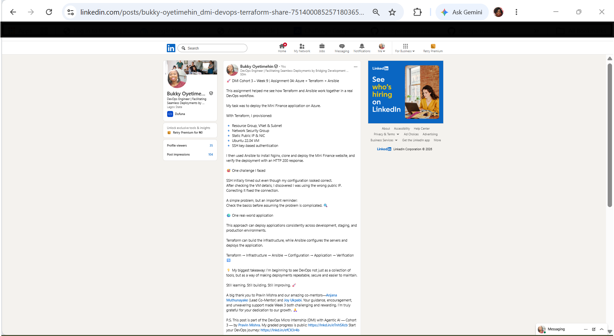

---

#### LinkedIn Post URL

Paste your LinkedIn post URL here:

`(https://lnkd.in/p/eXwEuR_P)`

---

### LinkedIn Submission Notes

**One challenge you faced and how you fixed it:**

I initially experienced an SSH connection timeout when trying to access the Azure VM. After checking the VM configuration, NSG rule, and public IP, I discovered that I was using the **wrong public IP address**. Once I corrected the IP in my SSH command, the connection worked successfully. 🔍

**Key lesson:** Always verify the basics before troubleshooting more complex issues.

---

**One real-world example where you can use this learning:**

I can use Terraform and Ansible to **automate the deployment of web applications across development, staging, and production environments**. Terraform can provision the cloud infrastructure consistently, while Ansible can configure the servers, install required software, and deploy the application. 🚀

---

# Assignment Questions

Answer the following in your own words:

**1. What did you provision using Terraform in this assignment?**

I used Terraform to provision the **Azure infrastructure for the Mini Finance application**, including a Resource Group, Virtual Network, subnet, Network Security Group, Static Public IP, Network Interface, and an **Ubuntu 22.04 virtual machine**.

I also configured the NSG to allow **SSH from my trusted IP** and **HTTP traffic**, while using SSH key-based authentication for secure access.

---

**2. What did Ansible configure and deploy in this assignment?**

Ansible configured the Azure VM by **installing and configuring Nginx, Git, and rsync**. It then cloned and deployed the **Mini Finance website** to the Nginx web root, set the correct file ownership, and reloaded Nginx when needed.

Finally, Ansible verified that the deployed website was accessible and returned **HTTP 200**. 🚀

---

**3. Why is SSH access on port `22` restricted to your public IP address?**

SSH access is restricted to my public IP address to **reduce the risk of unauthorized access** to the Azure VM. Only my trusted device/network can connect through port `22`, while other internet users are blocked.

This follows the **principle of least privilege**—allowing only the access that is actually needed. 🔐

---

**4. Why is HTTP port `80` open to the internet?**

HTTP port `80` is open to the internet because it allows **users to access the Mini Finance website through a web browser**. Unlike SSH, which is for administration, HTTP is a public-facing service that needs to be reachable by website visitors. 🌐

This allows anyone to access the deployed website using the VM's public IP address.

---

**5. What is the purpose of the Ansible inventory file?**

The Ansible inventory file tells Ansible **which servers to manage and how to connect to them**. In this assignment, it identifies the Azure VM, its public IP address, SSH user, and private key used for authentication. 🔧

It also allows us to group servers, such as putting the Mini Finance VM in the `web` group, so Ansible knows which hosts the playbook should run against.

---

**6. Why does the playbook use separate plays for install, deploy, and verify?**

The playbook uses separate plays to **keep each stage organized and focused**. 🔄

* **Install:** Sets up the required software such as Nginx, Git, and rsync.
* **Deploy:** Clones and deploys the Mini Finance website.
* **Verify:** Checks from the Ansible controller that the website is accessible and returns **HTTP 200**.

This makes the playbook **easier to understand, troubleshoot, maintain, and reuse**.

The playbook uses separate plays for **install**, **deploy**, and **verify** to give each stage a clear responsibility and execution boundary. Ansible runs plays and their tasks in order, so this structure creates a predictable deployment workflow.

## Reasons for separation

* **Clear organization:** Installation prepares the server, deployment places or updates the application, and verification confirms that the result works.
* **Easier troubleshooting:** If the playbook fails, you can quickly identify whether the problem is with package installation, application deployment, or service availability.
* **Selective execution:** You can run only the required stage using tags or by limiting the playbook—for example, redeploy changed website files without reinstalling Nginx.
* **Reusability:** The installation play can be reused when provisioning new servers, while the deployment play can be run regularly during releases.
* **Controlled ordering:** Verification runs only after installation and deployment have completed, ensuring that tests validate the final state rather than an incomplete setup.
* **Different host targeting:** Each play can target different inventory groups or use different privileges and variables. Ansible supports multiple plays specifically to orchestrate ordered operations across different sets of machines.

For example:

```yaml
- name: Install web server
  hosts: web
  become: true
  tasks:
    - name: Install Nginx
      apt:
        name: nginx
        state: present

- name: Deploy application
  hosts: web
  become: true
  tasks:
    - name: Copy website files
      copy:
        src: website/
        dest: /var/www/html/

- name: Verify deployment
  hosts: web
  tasks:
    - name: Check website response
      uri:
        url: http://localhost
        status_code: 200
```

This is not strictly required—everything could be placed in one play—but separate plays make the automation more maintainable, testable, and easier to operate in production.

---

**7. Why is `rsync` useful when deploying website files?**

`rsync` is useful for deploying website files because it synchronizes the destination with the source efficiently instead of copying every file on every deployment.

## Main benefits

* **Faster deployments:** It normally transfers only new or changed files, reducing deployment time and bandwidth usage.
* **Preserves file attributes:** Archive mode can preserve permissions, timestamps, ownership, symbolic links, and directory structure.
* **Supports exact mirroring:** The `--delete` option removes files from the server that no longer exist in the source, preventing outdated website assets from remaining active.
* **Works well for repeated deployments:** It is efficient when only a few HTML, CSS, JavaScript, or image files change between releases.
* **Can verify differences accurately:** The checksum option compares file contents instead of relying only on modification time and size, although it requires additional processing.
* **Integrates with Ansible:** Ansible’s `ansible.posix.synchronize` module is a wrapper around `rsync`, making it convenient to use in deployment playbooks.

Example:

```yaml
- name: Deploy website files
  ansible.posix.synchronize:
    src: ./website/
    dest: /var/www/html/
    archive: true
    delete: true
```

The trailing slash in `src: ./website/` means “copy the contents of `website` into `/var/www/html`.” Without the trailing slash, the directory itself may be copied inside the destination.

Be cautious with `delete: true`: it creates an exact mirror, so a file that exists on the server but not in the source will be removed. Always confirm the source and destination paths before using it in production.

---

**8. What does the Ansible `uri` module verify in this assignment?**

In this assignment, the Ansible `uri` module verifies that the deployed website is reachable and responding successfully over HTTP.

For example:

```yaml
- name: Verify website is available
  ansible.builtin.uri:
    url: http://localhost
    method: GET
    status_code: 200
```

## What it checks

* Sends an HTTP `GET` request to the website URL.
* Confirms that the web server responds.
* Checks that the returned HTTP status code is `200 OK`, which is the expected success code by default.
* Causes the verification task to fail if the server is unreachable or returns an unexpected status such as `404`, `500`, or `503`.
  
Therefore, it provides a basic **post-deployment health check**. It confirms that the site is serving requests, but it does not by itself prove that every page, database connection, API, or business feature is working correctly.

You can also verify specific content:

```yaml
- name: Verify homepage content
  ansible.builtin.uri:
    url: http://localhost
    return_content: true
    status_code: 200
  register: webpage

- name: Check expected text
  ansible.builtin.assert:
    that:
      - "'Welcome' in webpage.content"
```

Here, the first task checks availability and status, while the assertion checks whether the expected text appears in the returned page.

The Ansible `uri` module in Play 3 verifies that the website is **accessible over HTTP** from each managed server. It sends a GET request to the server's public IP address and checks the HTTP response.

In this assignment, the `uri` task expects a **200 OK** response. If the server returns HTTP 200, it confirms that Nginx is responding and the website is available.

The `assert` task then uses this result to confirm that both `web1` and `web2` are successfully serving the website.

---

**9. What issue did you face during this assignment, and how did you fix it?**

I faced an **SSH connection timeout** when trying to connect to the Azure VM. After checking the VM configuration, NSG rule, and public IP, I discovered that I was using the **wrong public IP address**. I corrected the IP in my SSH command, and the connection worked successfully. 🔍

**Lesson learned:** Always verify the basic details before troubleshooting more complex issues.

---

**10. What did you learn from using Terraform and Ansible together?**

I learned that Terraform and Ansible **complement each other**. Terraform provisions the cloud infrastructure, while Ansible configures the server and deploys the application.

Using them together makes the deployment process **more automated, consistent, repeatable, and easier to maintain**. 🚀

---

# Required Files

Confirm that the following files are included in your assignment folder:

* [ ] `.gitignore`
* [ ] `README.md`
* [ ] `terraform/providers.tf`
* [ ] `terraform/main.tf`
* [ ] `terraform/variables.tf`
* [ ] `terraform/outputs.tf`
* [ ] `ansible/inventory.ini`
* [ ] `ansible/site.yml`

---

# Submission Instructions

* Add all required screenshots in the correct order.
* Full Name must be visible in required screenshots.
* Add the Azure VM public IP address.
* Add the final Mini Finance website URL.
* Paste `inventory.ini`, `site.yml`, and `README.md` as editable text.
* Answer all assignment questions clearly in your own words.
* Add your LinkedIn post URL.
* Do not expose SSH private keys, passwords, Azure credentials, subscription IDs, Terraform state contents, or other sensitive information.

---

# Completion Checklist

* [ ] Task 1: `mini-finance` project structure created
* [ ] Task 1: `.gitignore` created
* [ ] Task 2: Terraform Azure infrastructure code created
* [ ] Task 2: `Allow-SSH` rule configured for port `22`
* [ ] Task 2: `Allow-HTTP` rule configured for port `80`
* [ ] Task 2: NSG associated with the Network Interface
* [ ] Task 3: `terraform fmt` completed
* [ ] Task 3: `terraform init` completed
* [ ] Task 3: `terraform validate` completed successfully
* [ ] Task 3: `terraform apply` completed successfully
* [ ] Task 3: `terraform output public_ip` displayed the VM public IP
* [ ] Task 4: Passwordless SSH works from the Ansible controller
* [ ] Task 5: `inventory.ini` created
* [ ] Task 5: Ansible ping returns `SUCCESS` and `pong`
* [ ] Task 6: `site.yml` contains three separate plays
* [ ] Task 6: Play 1 installs Nginx, Git, and rsync
* [ ] Task 6: Play 2 clones and deploys the Mini Finance website
* [ ] Task 6: Play 3 verifies HTTP status code `200`
* [ ] Task 7: Playbook syntax check passes
* [ ] Task 7: Ansible playbook completes successfully
* [ ] Task 7: Final recap shows `failed=0` and `unreachable=0`
* [ ] Task 8: Mini Finance website loads in the browser
* [ ] Task 8: Azure VM public IP is visible in the browser screenshot
* [ ] Task 9: `README.md` completed
* [ ] Screenshots 1–15 are included
* [ ] `inventory.ini`, `site.yml`, and `README.md` are pasted as editable text
* [ ] Assignment questions are answered
* [ ] LinkedIn post published with Anyone visibility
* [ ] LinkedIn post URL added
* [ ] No sensitive information is exposed

---

## About DMI & CloudAdvisory

DevOps Micro Internship (DMI) is a project-based DevOps program run by Pravin Mishra and The CloudAdvisory, focused on real-world execution, systems thinking, and career readiness.

It helps learners build strong DevOps foundations with hands-on experience.

---

## Resources

* DMI Official Website: [https://dmi.pravinmishra.com?utm_source=github&utm_medium=readme](https://dmi.pravinmishra.com?utm_source=github&utm_medium=readme)
* University: [https://university.pravinmishra.com?utm_source=github&utm_medium=readme](https://university.pravinmishra.com?utm_source=github&utm_medium=readme)
* Discord Community: [https://discord.pravinmishra.com?utm_source=github&utm_medium=readme](https://discord.pravinmishra.com?utm_source=github&utm_medium=readme)
* Blog: [https://dmi.pravinmishra.com/blog?utm_source=github&utm_medium=readme](https://dmi.pravinmishra.com/blog?utm_source=github&utm_medium=readme)
* YouTube Playlist: [https://www.youtube.com/playlist?list=PLFeSNDtI4Cho](https://www.youtube.com/playlist?list=PLFeSNDtI4Cho)
* Pravin Mishra LinkedIn: [https://www.linkedin.com/in/pravin-mishra-aws-trainer/](https://www.linkedin.com/in/pravin-mishra-aws-trainer/)
* CloudAdvisory LinkedIn: [https://www.linkedin.com/company/thecloudadvisory/](https://www.linkedin.com/company/thecloudadvisory/)

---

*This submission is part of DevOps Micro Internship (DMI) — Agentic AI Track.*
