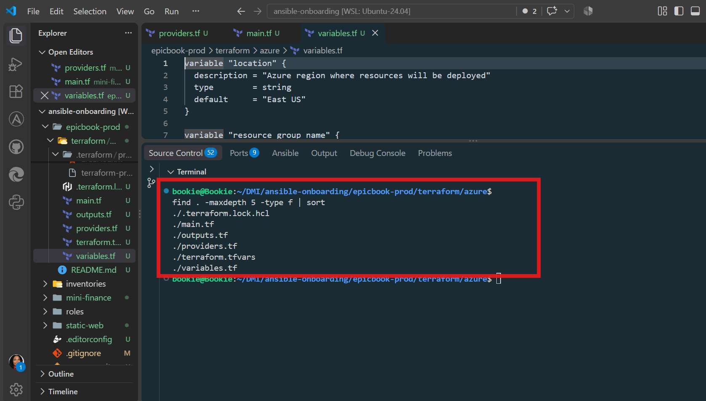
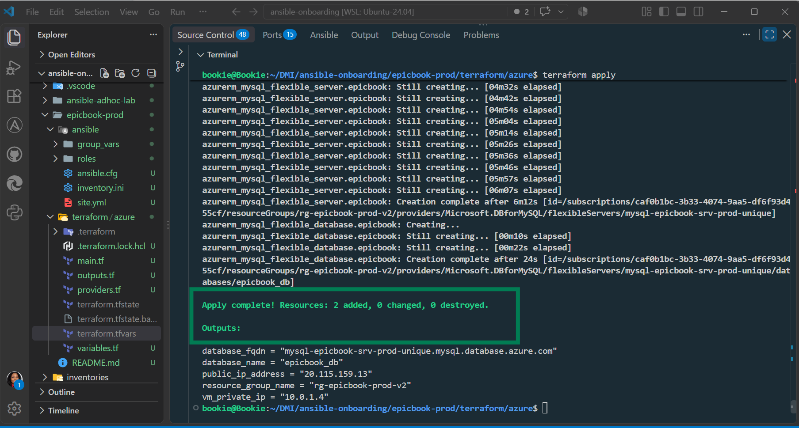
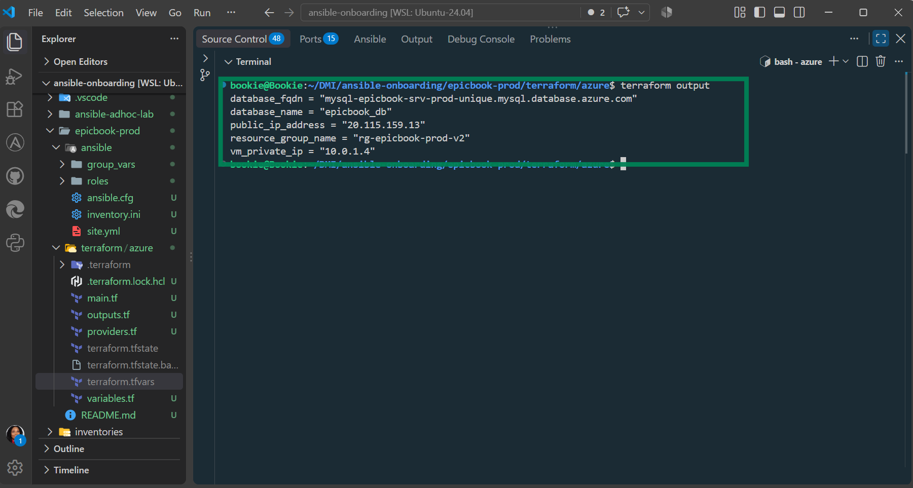
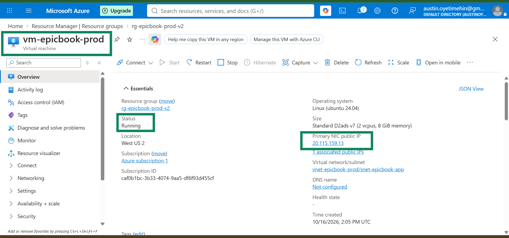
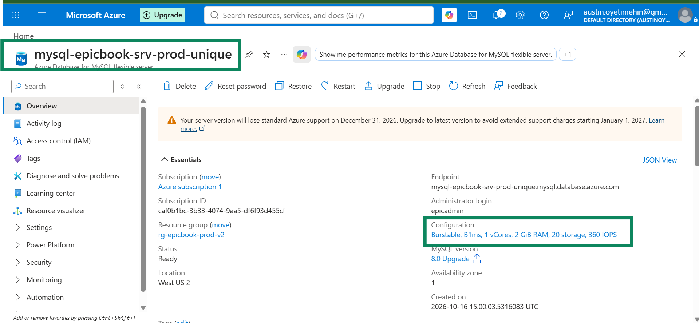

# Assignment — Deploy EpicBook with Terraform and Ansible Roles

Part of the DevOps Micro Internship (DMI) with Agentic AI

---

## Purpose

In this assignment, you will deploy the EpicBook web application using Terraform and Ansible roles.

Terraform provisions the cloud infrastructure, including one Ubuntu VM and one managed MySQL database. Ansible roles configure the VM, install required software, deploy the EpicBook application, configure Nginx, connect the app to the managed MySQL database, and verify the deployment.

---

# Task 1 — Set Up the Project Folder Layout

## Goal

Create the project folder structure for Terraform and Ansible roles.

Terraform will be used to provision the cloud infrastructure. Ansible roles will be used to configure the VM and deploy the EpicBook application.

### Evidence

#### Screenshot 1 — Terminal showing the completed `epicbook-prod` project structure

---

### Notes

Answer the following in your own words:

**1. Which cloud provider did you choose for this assignment?**

I chose **Microsoft Azure** as the cloud provider for this assignment. I used Azure because I have been working with Azure Terraform and Ansible in the previous assignments, so this allowed me to build on that experience while deploying EpicBook infrastructure.

---

**2. Why is it useful to keep Terraform files and Ansible files in separate folders?**

Keeping Terraform and Ansible files in separate folders makes the project easier to understand, manage, and maintain. **Terraform is responsible for creating the infrastructure**, such as the VM, network, and database, while **Ansible is responsible for configuring the VM and deploying the application**. Separating them keeps these responsibilities clear and makes the deployment easier to troubleshoot and reuse.

---

**3. What is the purpose of the `roles` directory in Ansible?**

The `roles` directory stores **reusable Ansible components**, with each role handling a specific responsibility. For example, in this assignment, the `common` role handles basic server setup, the `nginx` role configures Nginx, and the `epicbook` role deploys the application. This keeps the playbook organized, reusable, and easier to maintain.

---

# Task 2 — Provision the Infrastructure with Terraform

## Goal

Run Terraform to provision the cloud infrastructure for the EpicBook deployment.

Terraform will create the VM, managed MySQL database, networking, security rules, and required outputs.

### Evidence

#### Screenshot 2 — `terraform apply` completed successfully

---

#### Screenshot 3 — Output of `terraform output`

---

#### Screenshot 4 — Azure Portal or AWS Console showing the VM running

---

#### Screenshot 5 — Azure Portal or AWS Console showing the managed MySQL database created

---

### Notes

Answer the following in your own words:

**1. What resources did Terraform create for this assignment?**

For this deployment, Terraform created a secure, isolated two-tier cloud architecture inside Azure.
Here is the breakdown of the specific resources constructed to run and protect the EpicBook application:

1.Core Framework & Isolation

• Resource Group (azurerm_resource_group): A logical cloud folder that holds, organizes, and manages the lifecycle of all the infrastructure components we deployed.
• Virtual Network (azurerm_virtual_network): The isolated private network space in the cloud where all our components sit and securely communicate with each other.

2.Network Segmentation (Subnets)

• Application Subnet (azurerm_subnet): A dedicated slice of the network built specifically to house the public-facing Ubuntu web server.
• Database Subnet (azurerm_subnet): A locked-down, private slice of the network delegated specifically to Azure's MySQL service so it remains isolated from the public internet.

3.Compute Tier (The Web Server)

• Linux Virtual Machine (azurerm_linux_virtual_machine): A high-performance Ubuntu Linux virtual server (sized as a Standard_D2ads_v7 instance) that handles processing and runs the EpicBook app code.
• Public IP Address (azurerm_public_ip): A persistent, static public internet address assigned to our server so users and management tools can reach the application.
• Network Interface Card (azurerm_network_interface): The virtual network hardware attached to the VM, allowing it to pass traffic between its private subnet and its public IP.

4.Traffic Control & Security

• Network Security Group (azurerm_network_security_group): A virtual firewall containing our explicit security rules. It opens port 80 globally so anyone can access the website via HTTP, and selectively opens port 22 (SSH) so you can securely log in and manage the backend.
• NSG Association (azurerm_network_interface_security_group_association): The digital bridge that binds our custom firewall rules directly onto the virtual machine's network card.

5.Managed Database Tier

• MySQL Flexible Server (azurerm_mysql_flexible_server): A fully managed, secure MySQL database instance running on standalone infrastructure, configured with automatic backups and isolated networking.
• EpicBook Database (azurerm_mysql_flexible_database): The actual, isolated SQL database catalog built inside the server cluster where EpicBook will store its live application data.
• Private DNS Zone & Link (azurerm_private_dns_zone &_virtual_network_link): A private internal routing system that lets our Ubuntu server talk to the MySQL database securely using a friendly domain name link instead of an unstable internal IP address.

---
To understand how these components work together, it helps to look at them as a three-layer security perimeter.
By leveraging the private network design, Terraform has ensured that your database is completely invisible to the public internet, while still allowing your web application server to talk to it securely.
Here is exactly how these resources are linked together to protect your database:

### The Subnet Shield (Network Segmentation)

Instead of throwing all your infrastructure into one big bucket, Terraform explicitly split the Virtual Network into two completely isolated rooms:
• The Frontend Subnet (snet-epicbook-app): This room houses your Ubuntu web server. It is linked directly to a Public IP, meaning it can face the outside world to receive website traffic.
• The Backend Subnet (snet-epicbook-db): This room houses your MySQL Database. Crucially, it has no public IP address. It is entirely internal.

a. Service Delegation (Locking the Door)

During the subnet setup, you applied a rule called delegation to the database room. This tells Azure: "This room is exclusively reserved for the MySQL Flexible Server service. No standard computer, no hacker, and no other virtual machine can ever step inside this subnet." It creates a hard, logical boundary around the database hardware.

b. The Private DNS Zone (The Invisible Bridge)

Because the database has no public internet address, the Ubuntu web server needs a way to find it internally. Terraform solved this by creating a Private DNS Zone (://azure.com) and linking it to the network.
• This act creates an encrypted, internal routing path inside Azure's private backbone.
• Your web application server can talk to the database using a friendly private address (like mysql-epicbook-srv...), but someone trying to type that same address from their home computer on the public internet will get a "Server Not Found" error. It simply does not exist out there.

The Traffic Flow in Action

When a user visits your app, the traffic flows through a highly controlled chain:

1. The User requests the website → Hits the Public IP → Passes through the Network Security Group Firewall (which checks if they are allowed on port 80) → Arrives at your Ubuntu VM.
2. The Ubuntu VM processes the request and needs data → It sends an internal request over the Private DNS Link → Traverses the internal network safely → Hits the MySQL Database inside its hidden subnet.
3. The database answers the VM, and the VM answers the user. At no point can the user jump straight to the database.

---

**2. Why should you review `terraform plan` before running `terraform apply`?**

One should review terraform plan before running terraform apply for one primary reason: it acts as the ultimate safety net against accidental downtime, data loss, and unexpected cloud costs.
Running terraform plan is like reviewing a blueprint or a receipt before you sign a contract. It tells you exactly what Terraform is about to do before it makes permanent changes to your live cloud account.
Here is why this step is absolutely critical for any developer:
• Prevents Accidental Destruction (Data Loss): Certain small changes in a code file (like accidentally altering a database name, dropping an availability zone flag, or modifying a subnet configuration) cannot simply be "edited" in the cloud. Instead, Azure requires the old resource to be completely destroyed and a new one built from scratch. If you don't read the plan, you might accidentally approve the deletion of your live production database.
• Catches Syntax Errors and Typos Early: As you saw firsthand during our deployment setup with the DNS zone name error, running a plan forces Terraform to validate your code syntax and dependencies. It stops you before you send broken commands to the Azure API.
• Eliminates Cost Surprises: Cloud resources cost money. Reviewing the plan allows you to verify that you are deploying the exact size you intended (like your upgraded high-performance Standard_D2ads_v7 instance) instead of accidentally spinning up a massive, ultra-expensive enterprise server tier that could drain your budget overnight.
• The "Add, Change, Destroy" Scorecard: At the very bottom of every plan, Terraform gives one a concise summary (e.g., Plan: 11 to add, 0 to change, 0 to destroy.).

---

**3. Why should database passwords not be shown in Terraform output?**

Database passwords must never be exposed in Terraform outputs because doing so introduces a severe security vulnerability by exposing raw administrative credentials in plaintext.
Keeping passwords out of outputs ensures that the "keys to your castle" remain hidden from unauthorized eyes.
Here is why keeping passwords protected is an absolute requirement:
• Plaintext State Exposure: Terraform outputs are recorded directly into the local or remote state storage files (terraform.tfstate). If a password is printed as an output, it is written in unencrypted plaintext inside that file. Anyone with access to your project repository, CI/CD pipeline logs, or backup folders would be able to read your master database password instantly.
• Log Ingestion Risks: When you run commands in a terminal or automated deployment pipeline (like GitHub Actions or GitLab CI), anything printed to the screen is saved in execution logs. If a password is sent to the standard output, it gets cached forever in your build histories, creating an easy target for malicious actors or audit failures.
• Separation of Concerns: The sole job of Terraform is to build the hardware infrastructure, not to act as a password manager. Secrets should ideally be generated dynamically or injected securely through dedicated credential vaults (like Azure Key Vault or HashiCorp Vault) rather than handled as readable text outputs.

How Terraform Handles This Safely

Inside your code, you applied the sensitive = true argument to the mysql_admin_password variable. This tells Terraform: "I know you need this password to talk to Azure, but mask it on the screen." Instead of printing your password, Terraform will display (sensitive value) in the terminal outputs, ensuring your database remains safe and secure.

---

# Task 3 — Verify SSH Key-Based Access

## Goal

Verify that the cloud VM can be accessed from the Ansible controller using SSH key-based authentication.

### Evidence

#### Screenshot 6 — Successful SSH hostname check from the Ansible controller

Add your screenshot here.

---

### Notes

Answer the following in your own words:

**1. What command did you use to verify SSH access?**

Add your answer here.

---

**2. What proves that SSH key-based access worked successfully?**

Add your answer here.

---

**3. What would you check if SSH returned `Permission denied (publickey)`?**

Add your answer here.

---

# Task 4 — Create the Ansible Inventory and Configuration

## Goal

Create the Ansible inventory file and local Ansible configuration for the EpicBook VM.

The inventory tells Ansible which VM to manage and which SSH user to use.

### Evidence

#### Screenshot 7 — `inventory.ini` showing the VM under the `web` group

Add your screenshot here.

---

#### Screenshot 8 — Output of `ansible-inventory -i inventory.ini --graph`

Add your screenshot here.

---

#### Screenshot 9 — Output of `ansible web -i inventory.ini -m ping`

Add your screenshot here.

---

### Notes

Answer the following in your own words:

**1. What is the purpose of `inventory.ini`?**

Add your answer here.

---

**2. What does `ansible_host` store?**

Add your answer here.

---

**3. What does `ansible_ssh_private_key_file` tell Ansible?**

Add your answer here.

---

**4. Why is `host_key_checking = False` used only for this temporary lab?**

Add your answer here.

---

# Task 5 — Create the Main Ansible Playbook

## Goal

Create the main Ansible playbook that runs the required roles in the correct order.

The `site.yml` file will call the `common`, `nginx`, and `epicbook` roles.

### Evidence

#### Screenshot 10 — `site.yml` showing the roles in the correct order

Add your screenshot here.

---

#### Screenshot 11 — Output of `ansible-playbook -i inventory.ini site.yml --syntax-check`

Add your screenshot here.

---

### Notes

Answer the following in your own words:

**1. What is the purpose of `site.yml`?**

Add your answer here.

---

**2. Why should the roles run in the order `common`, `nginx`, and `epicbook`?**

Add your answer here.

---

**3. What does `become: true` allow Ansible to do?**

Add your answer here.

---

# Task 6 — Create the `common` Role

## Goal

Create the `common` role to prepare the Ubuntu VM with the basic packages required for the EpicBook deployment.

This role handles the common server setup before Nginx and the application are configured.

### Evidence

#### Screenshot 12 — `roles/common/tasks/main.yml` showing the common setup tasks

Add your screenshot here.

---

### Notes

Answer the following in your own words:

**1. What is the responsibility of the `common` role?**

Add your answer here.

---

**2. Why should Nginx installation not be placed inside the `common` role?**

Add your answer here.

---

**3. Why is `mysql-client` useful in this deployment?**

Add your answer here.

---

# Task 7 — Create the `nginx` Role

## Goal

Create the `nginx` role to install Nginx and configure it as a reverse proxy for the EpicBook application.

Nginx will receive browser traffic on port `80` and forward it to the EpicBook Node.js application running on the VM.

### Evidence

#### Screenshot 13 — `roles/nginx/tasks/main.yml` showing Nginx installation and site configuration tasks

Add your screenshot here.

---

#### Screenshot 14 — `roles/nginx/templates/epicbook.conf.j2` showing the reverse proxy configuration

Add your screenshot here.

---

### Notes

Answer the following in your own words:

**1. What is the responsibility of the `nginx` role?**

Add your answer here.

---

**2. Why is Nginx configured as a reverse proxy in this deployment?**

Add your answer here.

---

**3. Why should the application port come from `group_vars/web.yml` instead of being hard-coded?**

Add your answer here.

---

# Task 8 — Create the `epicbook` Role

## Goal

Create the `epicbook` role to deploy the EpicBook application, connect it to the managed MySQL database, and run the application on port `8080` using PM2.

### Evidence

#### Screenshot 15 — `roles/epicbook/tasks/main.yml` showing application deployment tasks

Add your screenshot here.

---

#### Screenshot 16 — Task or file showing how the database connection is configured, with secrets hidden

Add your screenshot here.

---

#### Screenshot 17 — Task or output showing the EpicBook application managed by PM2

Add your screenshot here.

---

### Notes

Answer the following in your own words:

**1. What is the responsibility of the `epicbook` role?**

Add your answer here.

---

**2. Why is PM2 used for the EpicBook Node.js application?**

Add your answer here.

---

**3. Why should database passwords not be hard-coded in public files?**

Add your answer here.

---

**4. What does it mean for the application to run on port `8080` while Nginx listens on port `80`?**

Add your answer here.

---

# Task 9 — Create Group Variables

## Goal

Create reusable variables for the EpicBook deployment.

The `group_vars/web.yml` file stores values that can be reused across the Ansible roles.

### Evidence

#### Screenshot 18 — `group_vars/web.yml` showing the application, PM2, and database variables, with passwords hidden or masked

Add your screenshot here.

---

### Notes

Answer the following in your own words:

**1. What is the purpose of `group_vars/web.yml`?**

Add your answer here.

---

**2. Which values did you store in `group_vars/web.yml`?**

Add your answer here.

---

**3. How did you handle the database password securely?**

Add your answer here.

---

# Task 10 — Run the Ansible Playbook

## Goal

Run the Ansible playbook to configure the VM and deploy the EpicBook application.

The playbook should run the roles in this order:

1. `common`
2. `nginx`
3. `epicbook`

### Evidence

#### Screenshot 19 — Ansible playbook output showing the roles running

Add your screenshot here.

---

#### Screenshot 20 — Final Ansible recap showing `failed=0`

Add your screenshot here.

---

#### Screenshot 21 — Output of `ansible web -i inventory.ini -m command -a "systemctl is-active nginx" --become`

Add your screenshot here.

---

#### Screenshot 22 — Output of `ansible web -i inventory.ini -m command -a "pm2 status"`

Add your screenshot here.

---

#### Screenshot 23 — Output of `ansible web -i inventory.ini -m command -a "curl -I http://localhost:8080"`

Add your screenshot here.

---

### Notes

Answer the following in your own words:

**1. What command did you run to execute the Ansible playbook?**

Add your answer here.

---

**2. How do you know all roles completed successfully?**

Add your answer here.

---

**3. What proves that Nginx is active?**

Add your answer here.

---

**4. What proves that PM2 is managing the EpicBook application?**

Add your answer here.

---

**5. What proves that the EpicBook application responds on port `8080`?**

Add your answer here.

---

# Task 11 — Verify the EpicBook Deployment

## Goal

Verify that the EpicBook application is running, accessible in the browser, and connected to the managed MySQL database.

### Evidence

#### Screenshot 24 — Output of `curl -I http://<public_ip>`

Add your screenshot here.

---

#### Screenshot 25 — Output of the cart API test command

Add your screenshot here.

---

#### Screenshot 26 — Output of the `/cart` HTTP status check

Add your screenshot here.

---

#### Screenshot 27 — Browser showing the EpicBook application loaded from `http://<public_ip>`

Add your screenshot here.

---

### Notes

Answer the following in your own words:

**1. What HTTP response did you receive from the public application URL?**

Add your answer here.

---

**2. What did the cart API test prove?**

Add your answer here.

---

**3. What did the `/cart` status check return?**

Add your answer here.

---

**4. What issue did you face during verification, and how did you fix it?**

Add your answer here.

---

# LinkedIn Post Required

## Evidence

#### LinkedIn Post URL

Paste your LinkedIn post URL here:

`Add your URL here`

---

#### Screenshot — Published LinkedIn post

Add your screenshot here.

---

# Assignment Questions

Answer the following in your own words:

**1. Why is Terraform used for infrastructure provisioning?**

Add your answer here.

---

**2. Why are Ansible roles useful for production-style deployments?**

Add your answer here.

---

**3. What is the purpose of `group_vars/web.yml`?**

Add your answer here.

---

**4. Why should database passwords not be committed to GitHub?**

Add your answer here.

---

**5. What is the purpose of Nginx in this deployment?**

Add your answer here.

---

**6. Why should the managed MySQL database not be publicly accessible?**

Add your answer here.

---

**7. Why is PM2 used for the EpicBook Node.js application?**

Add your answer here.

---

**8. What does idempotency mean in Ansible?**

Add your answer here.

---

**9. What issue did you face during the deployment, and how did you fix it?**

Add your answer here.

---

**10. What security improvement would you make before using this setup in production?**

Add your answer here.

---

# Required Files

Confirm that the following files are included in your GitHub repository or assignment folder:

- [ ] `README.md`
- [ ] Terraform files under either `terraform/azure/` or `terraform/aws/`
- [ ] `ansible/ansible.cfg`
- [ ] `ansible/inventory.ini`
- [ ] `ansible/site.yml`
- [ ] `ansible/group_vars/web.yml`
- [ ] `ansible/roles/common/tasks/main.yml`
- [ ] `ansible/roles/nginx/tasks/main.yml`
- [ ] `ansible/roles/nginx/templates/epicbook.conf.j2`
- [ ] `ansible/roles/epicbook/tasks/main.yml`

---

# Submission Instructions

- Add all required screenshots in your submission.
- Full Name must be visible in required screenshots.
- Mention the cloud provider used: Azure or AWS.
- Add the VM public IP address.
- Add the final application URL.
- Add Terraform output proof.
- Add Ansible role tree proof.
- Add all required notes and assignment question answers.
- Add your LinkedIn post URL.
- Do not expose SSH private keys, passwords, cloud credentials, database credentials, Terraform state files, subscription IDs, or account IDs.

---

# Completion Checklist

- [ ] Task 1: Project folder layout created
- [ ] Task 2: Terraform infrastructure provisioned
- [ ] Task 3: SSH key-based access verified
- [ ] Task 4: Ansible inventory and configuration created
- [ ] Task 5: Main Ansible playbook created
- [ ] Task 6: `common` role created
- [ ] Task 7: `nginx` role created
- [ ] Task 8: `epicbook` role created
- [ ] Task 9: Group variables created
- [ ] Task 10: Ansible playbook run completed
- [ ] Task 11: EpicBook deployment verified
- [ ] Terraform files created under only one cloud provider folder
- [ ] One Ubuntu VM was created
- [ ] One managed MySQL database was created
- [ ] SSH port `22` is restricted to the controller public IP
- [ ] HTTP port `80` is accessible
- [ ] MySQL port `3306` is not publicly open
- [ ] `ansible web -i inventory.ini -m ping` returns `SUCCESS`
- [ ] `site.yml` calls the roles in the correct order
- [ ] Database secrets are hidden or handled securely
- [ ] Nginx is active
- [ ] PM2 shows the EpicBook application running
- [ ] EpicBook responds on port `8080`
- [ ] Public URL loads in the browser
- [ ] Cart API verification works
- [ ] Playbook completes with `failed=0`
- [ ] Screenshots 1–27 are included
- [ ] Assignment questions are answered
- [ ] LinkedIn post published
- [ ] LinkedIn post URL added
- [ ] No sensitive information is exposed

---

## About DMI & CloudAdvisory

DevOps Micro Internship (DMI) is a project-based DevOps program run by Pravin Mishra and The CloudAdvisory, focused on real-world execution, systems thinking, and career readiness.

It helps learners build strong DevOps foundations with hands-on experience.

---

## Resources

- DMI Official Website: [https://dmi.pravinmishra.com?utm_source=github&utm_medium=readme](https://dmi.pravinmishra.com?utm_source=github&utm_medium=readme)
- University: [https://university.pravinmishra.com?utm_source=github&utm_medium=readme](https://university.pravinmishra.com?utm_source=github&utm_medium=readme)
- Discord Community: [https://discord.pravinmishra.com?utm_source=github&utm_medium=readme](https://discord.pravinmishra.com?utm_source=github&utm_medium=readme)
- Blog: [https://dmi.pravinmishra.com/blog?utm_source=github&utm_medium=readme](https://dmi.pravinmishra.com/blog?utm_source=github&utm_medium=readme)
- YouTube Playlist: [https://www.youtube.com/playlist?list=PLFeSNDtI4Cho](https://www.youtube.com/playlist?list=PLFeSNDtI4Cho)
- Pravin Mishra LinkedIn: [https://www.linkedin.com/in/pravin-mishra-aws-trainer/](https://www.linkedin.com/in/pravin-mishra-aws-trainer/)
- CloudAdvisory LinkedIn: [https://www.linkedin.com/company/thecloudadvisory/](https://www.linkedin.com/company/thecloudadvisory/)

---

*This submission is part of DevOps Micro Internship (DMI) — Agentic AI Track.*