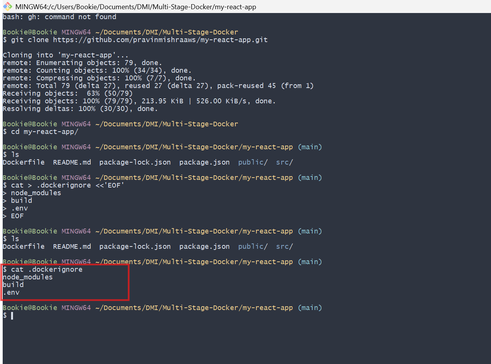
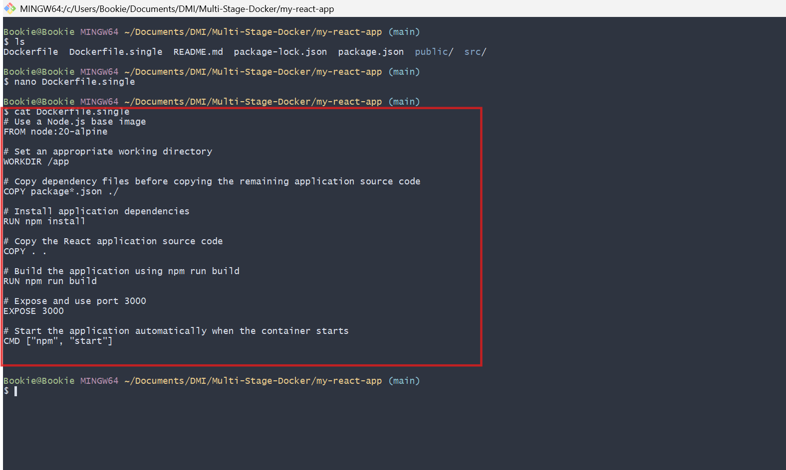
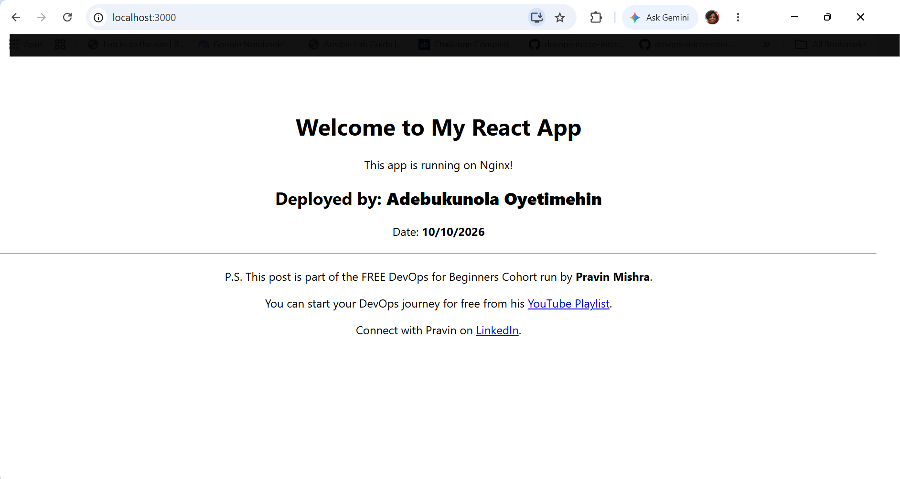
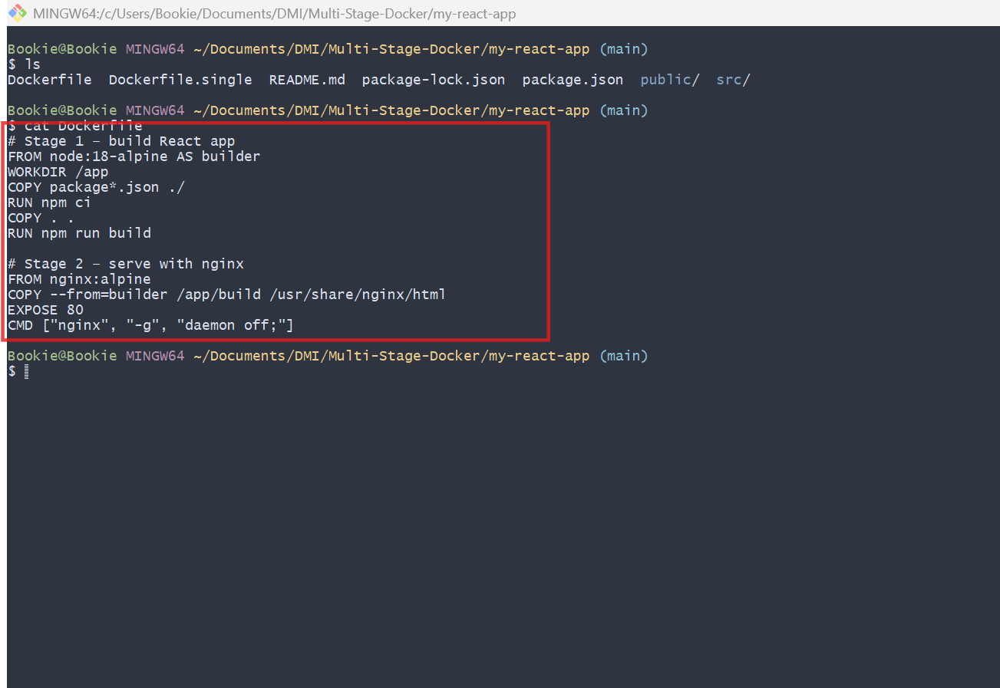
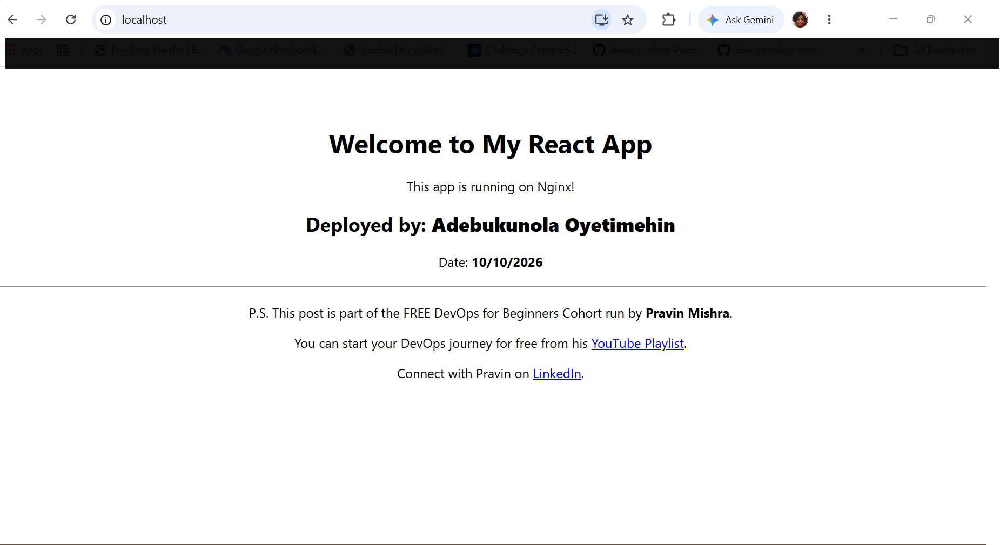
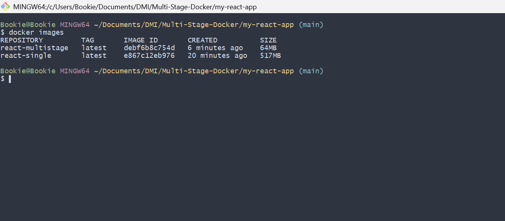
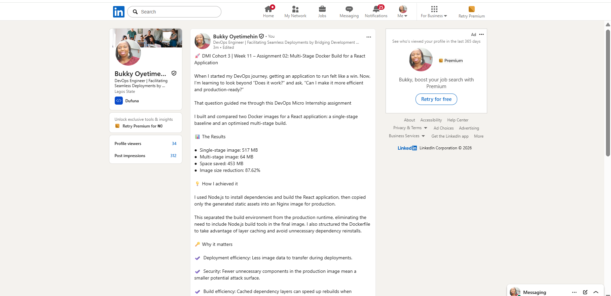

# Assignment 2 — Multi-Stage Docker Build for a React Application

Part of the DevOps Micro Internship (DMI) with Agentic AI

---

## Purpose

In this assignment, you will build both a single-stage and an optimized multi-stage Docker image for a React application, compare the resulting image sizes, and deploy the optimized version using a production-ready Nginx runtime container.

Complete this assignment locally on your own computer where Docker is installed and running.

---

# Task 1 — Prepare the Project

## Goal

Prepare the React application for Docker image creation.

### Evidence

#### Screenshot 1 — Contents of the `.dockerignore` File

Add a screenshot of the terminal showing:

```bash
cat .dockerignore
```

The file must exclude `node_modules`, `build`, and `.env`.



---

# Task 2 — Create a Single-Stage Docker Image

## Goal

Create a baseline single-stage Docker image and run the application on port 3000.

### Evidence

#### Screenshot 2 — Contents of `Dockerfile.single`

Add a screenshot showing the completed `Dockerfile.single`.



---

#### Screenshot 3 — Single-Stage Application in Browser

Add a screenshot of the browser showing the application at:

```text
http://localhost:3000
```

Ensure that your full name is visible in the application.



---

# Task 3 — Create a Multi-Stage Docker Build

## Goal

Create an optimized multi-stage Docker image with separate builder and Nginx runtime stages, then run the application on port 80.

### Evidence

#### Screenshot 4 — Contents of the Multi-Stage Dockerfile

Add a screenshot showing the completed multi-stage `Dockerfile`.



---

#### Screenshot 5 — Multi-Stage Application in Browser

Add a screenshot of the browser showing the application at:

```text
http://localhost
```

Ensure that your full name is visible in the application.



---

# Task 4 — Compare Docker Image Sizes

## Goal

Compare the single-stage and multi-stage image sizes and calculate the percentage reduction.

### Evidence

#### Screenshot 6 — Docker Image Size Comparison

Add a screenshot of the terminal showing:

```bash
docker images
```

The output must include both:

```text
react-single:latest
react-multistage:latest
```



---

### Percentage Reduction Calculation

Record the image sizes and calculate the reduction using the same unit for both images.

```text
Single-stage image size: 517MB

Multi-stage image size: 64MB

Percentage reduction =
((Single-stage image size − Multi-stage image size)
÷ Single-stage image size) × 100

Percentage reduction: 87.62%
```

---

# Task 5 — Analyze the Optimization Results

## Goal

Evaluate the advantages of using multi-stage Docker builds.

### Notes

Write a short analysis of 5–8 lines covering:

- The single-stage and multi-stage image sizes
- The percentage reduction in image size
- Security benefits of the smaller runtime image
- How a smaller runtime image reduces the attack surface
- How smaller images improve image pull and deployment speed
- One Docker build-caching optimization you used

## Task 5 — Optimization Results Analysis

### Metric Analysis & Percentage Reduction

Transitioning from a traditional single-stage build to a production-optimized multi-stage Docker build dropped the final image size from **517MB (`react-single`)** down to just **64MB (`react-multistage`)**, delivering a massive **87.62% reduction** in total footprint.

The mathematical breakdown is as follows:

- **Formula:** `((Single-stage size - Multi-stage size) / Single-stage size) * 100`
- **Calculation:** `((517MB - 64MB) / 517MB) * 100 = (453MB / 517MB) * 100 = 87.62%`

### Security Benefits & Reduced Attack Surface

By completely stripping out the heavy Node.js runtime, source code, development frameworks, and the bulky `node_modules` directory, the final runtime container relies strictly on a lean Nginx environment. This approach drastically reduces the application's attack surface. Eliminating unnecessary system-level tools means malicious actors have no pre-installed package managers (`npm`), shell utilities, or build compilers to exploit if a container breach ever occurs.

### Pull and Deployment Speeds

Shifting to a minimal 64MB production asset exponentially accelerates image pull and deployment speeds within CI/CD pipelines and cloud clustering environments (like Kubernetes or Amazon ECS). Decreased image size minimizes network latency and registry bandwidth consumption, enabling lightning-fast horizontal autoscaling.

### Docker Build-Caching Optimization

This implementation effectively leverages layer caching optimizations by strategically separating application dependencies from code changes. By processing `COPY package*.json ./` and `RUN npm install` sequentially *before* bringing in the remaining source files (`COPY . .`), Docker caches the intermediate dependencies layer. Subsequent builds skip downloading external node modules unless `package.json` changes, drastically shortening build loops.

### Comparative Summary

| Optimization Metric | Single-Stage Baseline (`react-single`) | Multi-Stage Production (`react-multistage`) | Performance & Security Impact |
| :--- | :--- | :--- | :--- |
| **Image Disk Size** | 517 MB | **64 MB** | **87.62% space reduction** |
| **Underlying Engine** | Node.js Runtime Engine | **Nginx Web Server** | Eliminates engine execution overhead |
| **Asset Composition** | Source files, dev tools, `node_modules` | **Compiled HTML/JS/CSS assets** | No raw code or dev-tool traces leak |
| **Deployment Profile** | Slow pull / high payload signature | **Blazing-fast cluster distribution** | Maximizes CI/CD throughput speeds |
| **Attack Vulnerability** | High (full toolsets present) | **Drastically minimized surface area** | No local compilers or scripts to exploit |

---

# Task 6 — Explore Additional Production Optimizations (Optional)

## Goal

Explore one or more additional production optimization techniques.

### Optional Work

You may choose to:

- Configure an Nginx health check
- Configure cache headers for static assets
- Experiment with a lighter runtime image
- Compare the resulting image size with your original multi-stage image

Screenshots are optional.

---

# LinkedIn Requirement

## Goal

Create a LinkedIn post describing what you built, what a multi-stage Docker build is, the image-size reduction achieved, and key learnings from the assignment.

### Evidence

#### LinkedIn Post URL

Paste your LinkedIn post URL here:

`(https://lnkd.in/p/e65v8h4h)`

---

#### LinkedIn Post Screenshot



---

# Submission Instructions

- Complete all required tasks in sequence.
- Include Screenshots 1–6 exactly as specified.
- Include the percentage-reduction calculation and Task 5 analysis.
- Include the LinkedIn post URL and screenshot.
- Ensure that your full name is visible in all required screenshots.
- Do not expose passwords, keys, tokens, account IDs, or other sensitive information.

---

# Completion Checklist

- [ ] Assignment completed locally
- [ ] `.dockerignore` created and verified (Screenshot 1)
- [ ] `Dockerfile.single` created (Screenshot 2)
- [ ] Single-stage container verified in the browser (Screenshot 3)
- [ ] Multi-stage `Dockerfile` created (Screenshot 4)
- [ ] Multi-stage container verified in the browser (Screenshot 5)
- [ ] Both Docker image sizes captured (Screenshot 6)
- [ ] Percentage reduction calculated
- [ ] Optimization analysis completed
- [ ] LinkedIn post URL and screenshot included
- [ ] Full name visible in all required screenshots
- [ ] No sensitive information exposed

---

## About DMI & CloudAdvisory

DevOps Micro Internship (DMI) is a project-based DevOps program run by Pravin Mishra (The CloudAdvisory), focused on real-world execution, systems thinking, and career readiness.

It helps learners build strong DevOps foundations through hands-on experience.

---

## 📌 About DMI & CloudAdvisory

DevOps Micro Internship (DMI) is a project-based DevOps program run by Pravin Mishra (The CloudAdvisory) focused on real-world execution, systems thinking, and career readiness.

It helps learners build strong DevOps foundations with hands-on experience.

---

## 📌 Resources

- 🌐 DMI Official Website: https://dmi.pravinmishra.com?utm_source=github&utm_medium=readme  
- 🎓 University: https://university.pravinmishra.com?utm_source=github&utm_medium=readme  
- 💬 Discord Community: https://discord.pravinmishra.com?utm_source=github&utm_medium=readme  
- 📝 Blog: https://dmi.pravinmishra.com/blog?utm_source=github&utm_medium=readme  
- ▶️ YouTube Playlist: https://www.youtube.com/playlist?list=PLFeSNDtI4Cho  
- 🔗 Pravin Mishra (LinkedIn): https://www.linkedin.com/in/pravin-mishra-aws-trainer/  
- 🏢 CloudAdvisory (LinkedIn): https://www.linkedin.com/company/thecloudadvisory/

---

*This submission is part of DevOps Micro Internship (DMI) — Agentic AI Track.*
