# Assignment 3 — Docker Networking

Part of the DevOps Micro Internship (DMI) with Agentic AI

---

## Purpose

In this assignment, you will explore Docker networking by using default bridge, custom bridge, multiple bridge, and host network modes. You will verify container communication, service discovery, network isolation, public access, and host networking on a Linux VM or EC2 instance.

---

# Task 1 — Deploy a Standalone Application Using the Default Bridge Network

## Goal

Deploy an Nginx web server using Docker’s default bridge network and access it through the VM public IP address.

### Evidence

#### Screenshot 1 — Available Docker Networks

Add a screenshot of the terminal showing:

```bash
docker network ls
```

The output must include the default `bridge`, `host`, and `none` networks.

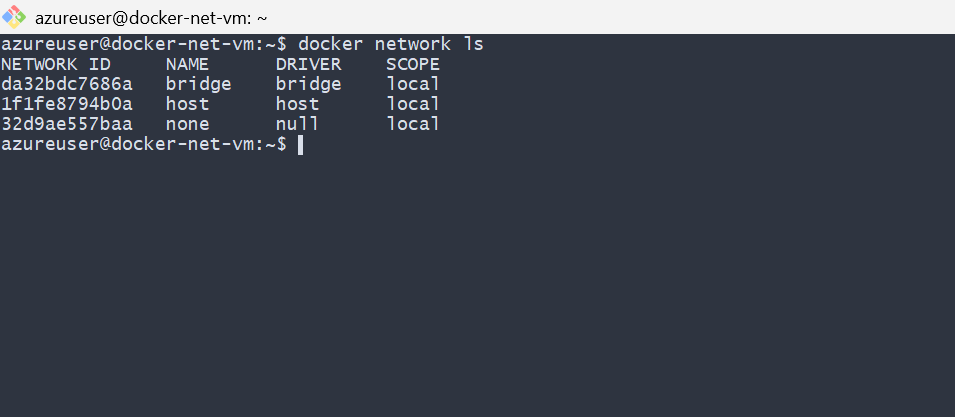

---

#### Screenshot 2 — Nginx Image Pull

Add a screenshot of the terminal showing successful completion of:

```bash
docker pull nginx:alpine
```

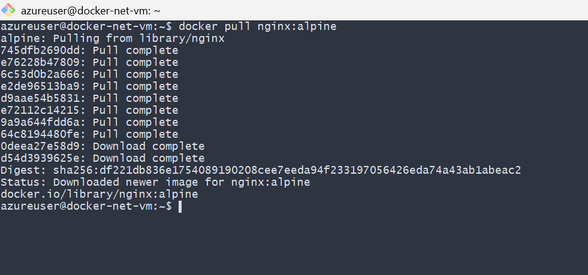

---

#### Screenshot 3 — docker pull nginx:alpine

Add a screenshot of the terminal showing:

```bash
docker ps
```

The output must show the running `myweb` container with:

```text
0.0.0.0:80->80/tcp
```

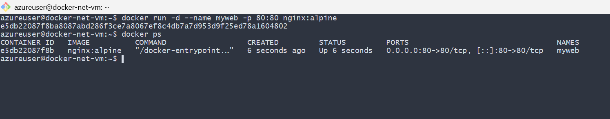

---

#### Screenshot 4 — Nginx Welcome Page

Add a browser screenshot showing the Nginx Welcome Page at:

```text
http://<20.127.27.0>
```

Ensure that the VM public IP is visible in the address bar. Add your full name as a clear caption directly below the screenshot.

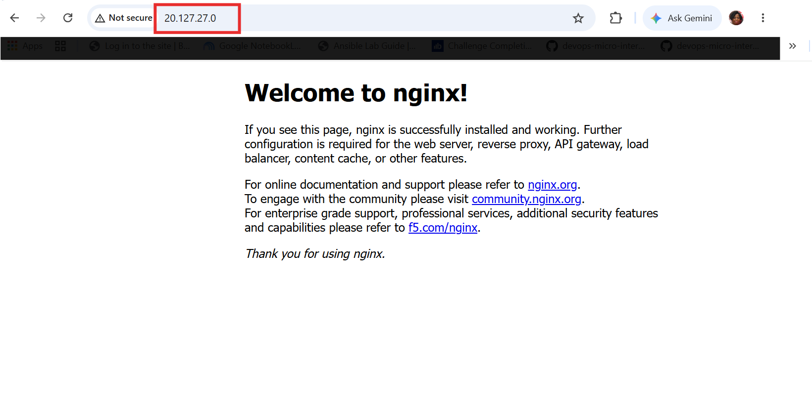

---

# Task 2 — Connect Containers Using a Custom Bridge Network

## Goal

Create a custom bridge network and verify that containers can communicate using container names rather than IP addresses.

### Evidence

#### Screenshot 5 — Custom Bridge Network Created

Add a screenshot of the terminal showing `mynetwork` in:

```bash
docker network ls
```

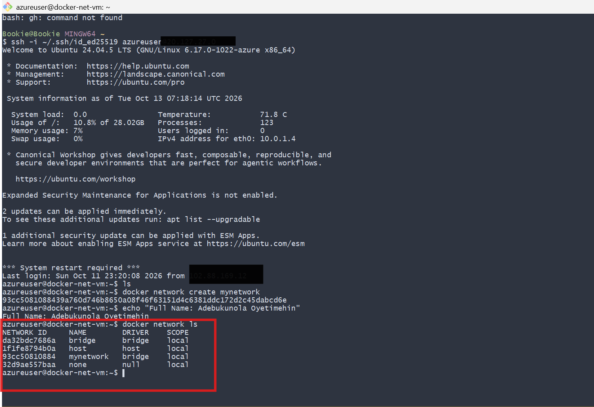

---

#### Screenshot 6 — Running `web` and `client` Containers

Add a screenshot of the terminal showing:

```bash
docker ps
```

The output must show both `web` and `client` containers running without published host ports.

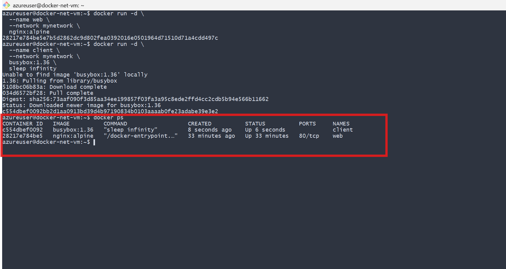

---

#### Screenshot 7 — Service Discovery by Container Name

Add a screenshot of the terminal showing successful output from:

```bash
docker exec client wget -qO- http://web
```

The output must display the Nginx Welcome Page HTML.

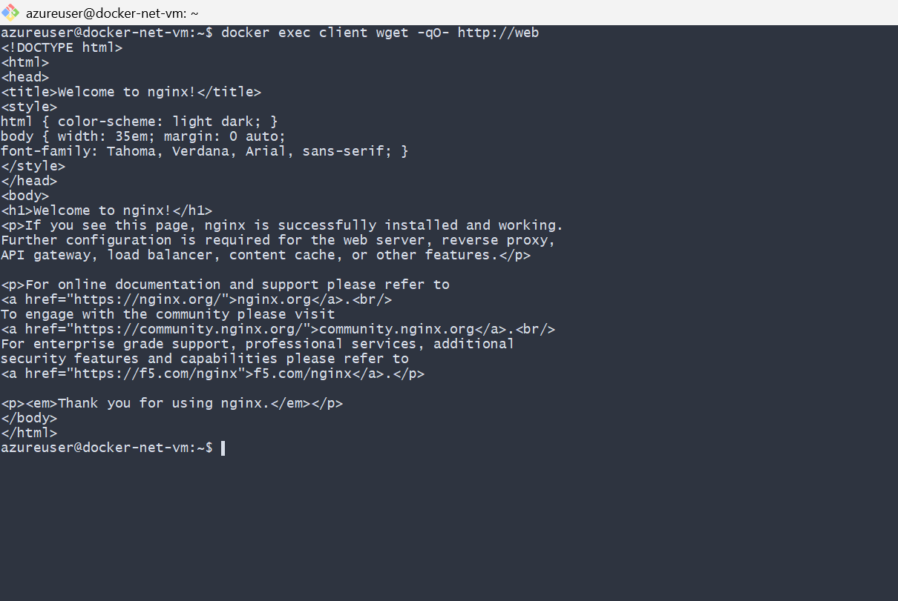

---

#### Screenshot 8 — Custom Network Inspection

Add a screenshot of the terminal showing:

```bash
docker network inspect mynetwork
```

The output must show both `web` and `client` connected to `mynetwork`.

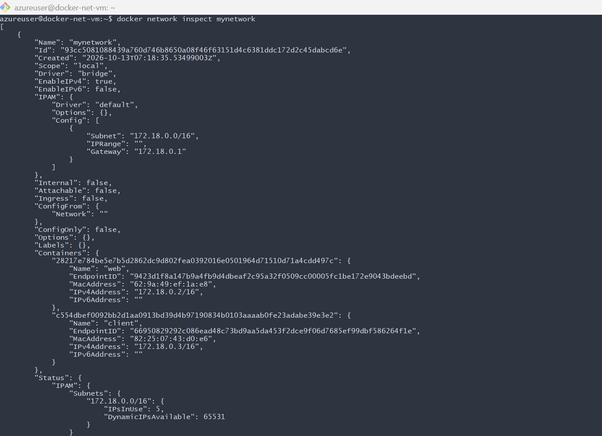

---

# Task 3 — Demonstrate Multi-Network Isolation

## Goal

Deploy frontend, backend, and database containers across two separate Docker networks. Verify allowed communication and confirm that the frontend cannot directly reach the database.

### Evidence

#### Screenshot 9 — Two Docker Networks

Add a screenshot of the terminal showing:

```bash
docker network ls
```

The output must include both `frontend-network` and `backend-network`.

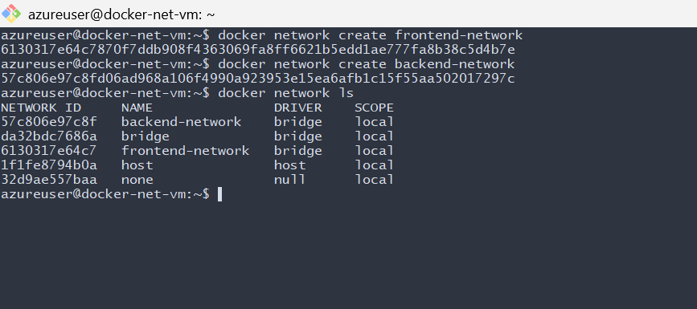

---

#### Screenshot 10 — Running Multi-Network Containers

Add a screenshot of the terminal showing:

```bash
docker ps
```

The output must show:

- `frontend` with the published port mapping `0.0.0.0:80->80/tcp`
- `backend` without a published host port
- `db` without a published host port

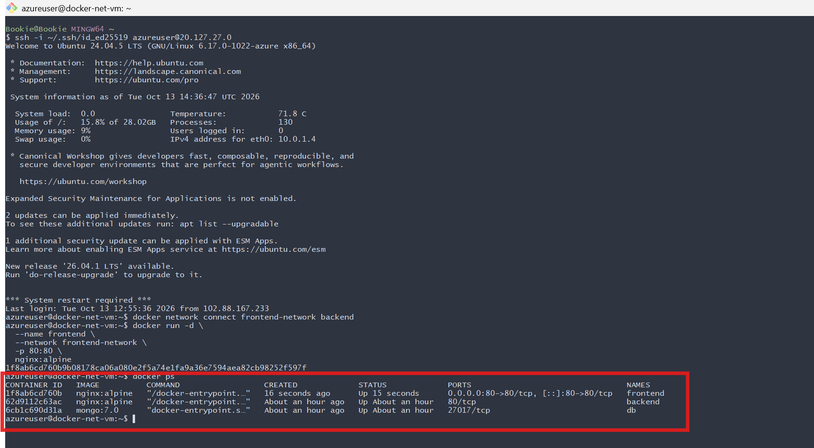

---

#### Screenshot 11 — Frontend Network Inspection

Add a screenshot of the terminal showing:

```bash
docker network inspect frontend-network
```

The output must show `frontend` and `backend`.

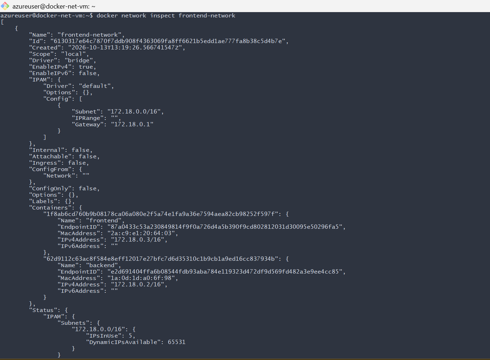

---

#### Screenshot 12 — Backend Network Inspection

Add a screenshot of the terminal showing:

```bash
docker network inspect backend-network
```

The output must show `backend` and `db`.

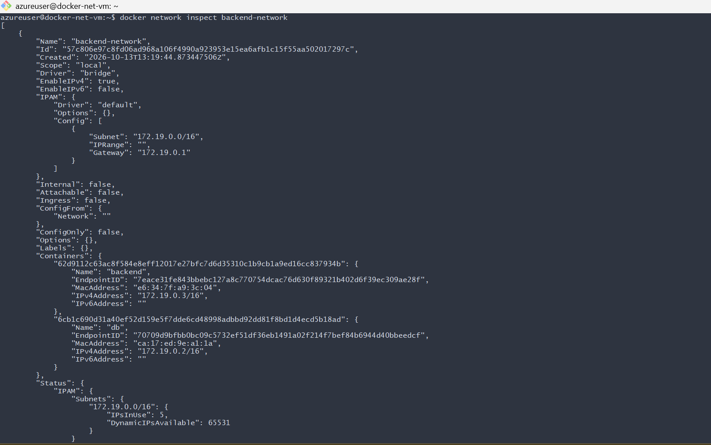

---

#### Screenshot 13 — Frontend-to-Backend Communication

Add a screenshot of the terminal showing successful output from:

```bash
docker exec frontend wget -qO- http://backend
```

The output must display the Nginx Welcome Page HTML.

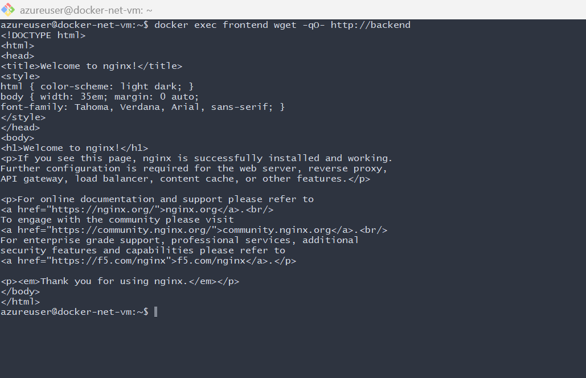

---

#### Screenshot 14 — Backend-to-Database Communication

Add a screenshot of the terminal showing a successful connection to `db` on port `27017` from the `backend` container.

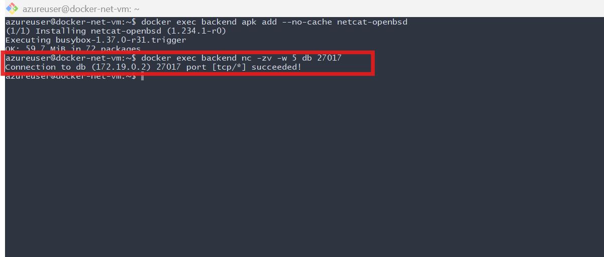

---

#### Screenshot 15 — Frontend-to-Database Isolation

Add a screenshot of the terminal showing that the `frontend` container cannot reach `db` on port `27017`.

The output must include:

```text
Expected result: frontend cannot reach db
```

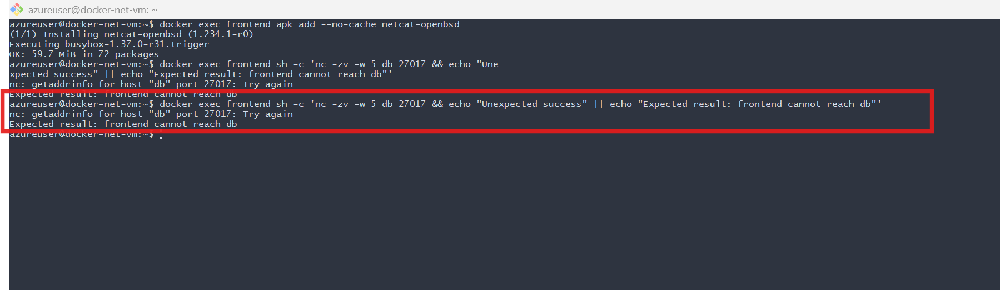

---

#### Screenshot 16 — Public Frontend Access

Add a browser screenshot showing the Nginx Welcome Page from the `frontend` container at:

```text
http://<YOUR-VM-PUBLIC-IP>
```

Ensure that the VM public IP is visible in the address bar. Add your full name as a clear caption directly below the screenshot.

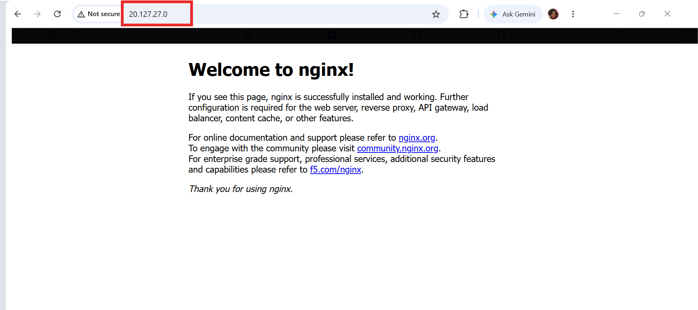

---

# Task 4 — Deploy an Application Using Docker Host Network Mode

## Goal

Run an Nginx container using Docker host network mode and compare it with bridge networking.

### Evidence

#### Screenshot 17 — Running Host-Networked Container

Add a screenshot of the terminal showing:

```bash
docker ps
```

The output must show the running `fastapp` container.

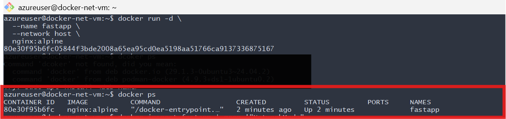

---

#### Screenshot 18 — Host Network Mode Verification

Add a screenshot of the terminal showing output from:

```bash
docker inspect fastapp | grep '"NetworkMode"'
```

The output must confirm:

```text
"NetworkMode": "host"
```

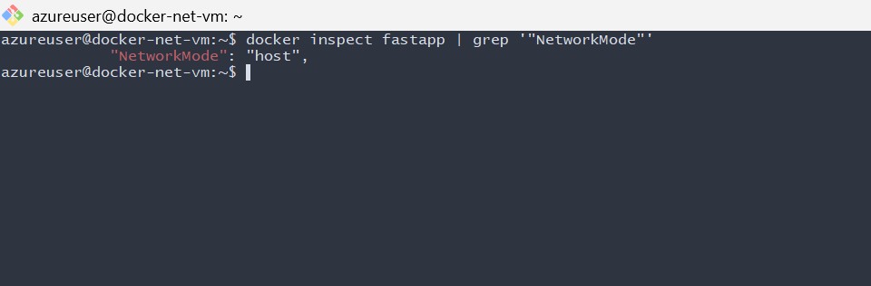

---

#### Screenshot 19 — Host-Networked Nginx Page

Add a browser screenshot showing the Nginx Welcome Page at:

```text
http://<YOUR-VM-PUBLIC-IP>
```

Ensure that the VM public IP is visible in the address bar. Add your full name as a clear caption directly below the screenshot.

[Assignment 03 Screenshot](screenshots/week-11-screenshot-36.png)

---

#### Screenshot 20 — Host-Networked Container Cleanup

Add a screenshot of the terminal showing successful completion of:

```bash
docker stop fastapp
docker rm fastapp
```

[Assignment 03 Screenshot](screenshots/week-11-screenshot-37.png)

---

# Networking Notes

Write a short note explaining:

- Default bridge networking
- Container-name communication on a custom bridge network
- Why the frontend could not access the database in Task 3
- The difference between bridge mode and host network mode

### 1. Default Bridge Networking

Docker's default bridge network allows containers to communicate with each other using their IP addresses. Containers can access external networks through the host, and ports can be published to make container services accessible from outside.

### 2. Container-Name Communication on a Custom Bridge Network

A custom bridge network provides automatic DNS resolution, allowing containers to communicate using their container names instead of IP addresses. This makes communication easier and more reliable when container IP addresses change.

### 3. Why the Frontend Could Not Access the Database in Task 3

The frontend was connected only to `frontend-network`, while the database was connected only to `backend-network`. Since the frontend and database did not share a network, they could not communicate directly. The backend connected to both networks, allowing it to communicate with both containers. However, Docker does not automatically forward traffic between networks; the backend application must handle requests between them.

#### Backend Communication

The `backend` container acts as the middle layer between the frontend and the database. It is connected to both Docker networks, while the frontend and database are connected to only one network each.

Frontend container

Connected to `frontend-network` only

Backend container

Connected to both networks

Database container (`db`)

Connected to `backend-network` only

Logical application flow: frontend → backend → database

#### How the communication works

1. Frontend → Backend: The frontend sends a request to the backend using its container name, provided the backend application is listening on the relevant port.
2. Backend → Database: The backend processes the request and connects to the database using the database container's name and database port, such as `db:3306` for MySQL.
3. Database → Backend: The database returns the query results to the backend.
4. Backend → Frontend: The backend sends a response to the frontend.

#### Why can't the frontend connect directly to the database?

The frontend and database do not share a Docker network. Therefore, the frontend cannot directly resolve or reach the database through Docker's network connectivity.

Important distinction: Docker does not automatically route application requests through the backend just because it connects to both networks. The backend application must explicitly receive requests and make database connections.

The backend container serves as an intermediary between the frontend and database. It connects to both `frontend-network` and `backend-network`, allowing it to communicate with the frontend on one network and the database on the other. The frontend sends requests to the backend, which processes them and queries the database when necessary. The database returns results to the backend, which then responds to the frontend. Since the frontend and database do not share a network, the frontend cannot access the database directly. This network separation improves isolation and supports a layered application architecture.

#### How Backend Communication Works (Beginner-Friendly) 🐳

Think of the backend as a waiter in a restaurant. The frontend is the customer, and the database is the kitchen where information is stored.

Frontend — The Customer

Requests information from the application.

Connected to `frontend-network`

Backend — The Waiter

Receives the request and asks the database for information.

Connected to both networks

Database — The Kitchen

Stores information and returns the requested data.

Connected to `backend-network`

The response travels back from the database through the backend to the frontend.

#### Why can't the frontend talk directly to the database?

Imagine the customer is not allowed into the kitchen. They must ask the waiter to get what they need.

It's similar with our Docker networks:

- The frontend can communicate with the backend because they share `frontend-network`.
- The backend can communicate with the database because they share `backend-network`.
- The frontend cannot directly communicate with the database because they are on separate networks.

The backend must have an application running that receives requests from the frontend and communicates with the database. Docker does not automatically make the backend do this.

The backend acts as a middleman between the frontend and the database. The frontend sends requests to the backend, and the backend communicates with the database to retrieve or store information. The database sends its response back to the backend, which then returns it to the frontend. The frontend cannot directly access the database because they are connected to different Docker networks. The backend is connected to both networks, allowing it to communicate with both containers. This setup improves network isolation and helps protect the database from direct access by the frontend.

### 4. Difference Between Bridge Mode and Host Network Mode

Bridge mode gives a container its own network interface and IP address, and port publishing (using `-p`) can expose its services. Host network mode shares the Linux host's network namespace, so the container uses the host's network interfaces and ports directly. It does not require port publishing, but services can experience port conflicts with applications running on the host.

Your comparison is good. 👍 Here is a slightly more beginner-friendly and technically precise version for your DMI assignment.

| Feature           | Bridge Network Mode 🌉                                                             | Host Network Mode 🖥️                                                               |
| ----------------- | ---------------------------------------------------------------------------------- | ----------------------------------------------------------------------------------- |
| Network isolation | The container has its own network interface and private IP address.                | The container shares the host's network namespace.                                  |
| Port mapping      | Use `-p` when you want to publish a container port on the host.                    | No `-p` is needed; the application uses the host's network ports directly.          |
| Performance       | May add some networking overhead, depending on the traffic path and configuration. | Can reduce networking overhead because it avoids the usual bridge and NAT path.     |
| Port conflicts    | Published host ports must be available.                                            | The application cannot use a host port that is already occupied by another service. |
| Example command   | `docker run -d -p 8080:80 nginx:alpine`                                            | `docker run -d --network host nginx:alpine`                                         |

#### Simple explanation

- Bridge mode: Think of the container as a house with its own address. Docker manages how traffic gets in and out.
- Host mode: Think of the container as using the host VM's network address and ports directly.

Conclusion: Bridge mode provides network separation and flexible port publishing, while host mode offers more direct access to the host's networking and may reduce overhead. Host mode is not automatically faster in every situation, and its reduced network isolation can have security implications.

---

# LinkedIn Requirement

## Goal

Create a LinkedIn post about the Docker networking modes explored, one key lesson about container isolation, and the learning outcomes from this assignment.

### Evidence

#### LinkedIn Post URL

!
Paste your LinkedIn post URL here:

`(https://lnkd.in/p/eK3VBYip)`

---

#### LinkedIn Post Screenshot

[Assignment 03 Screenshot](screenshots/week-11-screenshot-38.png)

---

# Submission Instructions

- Complete all tasks in sequence.
- Include Screenshots 1–20 exactly as specified.
- Include the Networking Notes section.
- Include the LinkedIn post URL and screenshot.
- Ensure that your full name is visible in all terminal screenshots.
- Add your full name as a caption below each browser screenshot that shows the standard Nginx page.
- Do not expose private keys, passwords, access keys, tokens, account IDs, or other sensitive information.

---

# Completion Checklist

- [ ] Completed on a Linux VM or EC2 instance
- [ ] Docker Engine is running
- [ ] HTTP port 80 is allowed in the VM firewall or cloud security rules
- [ ] Default bridge networking verified
- [ ] Custom bridge network created
- [ ] Container-name communication verified
- [ ] `frontend-network` and `backend-network` created
- [ ] Frontend-to-backend communication verified
- [ ] Backend-to-database communication verified
- [ ] Frontend-to-database isolation verified
- [ ] Only the frontend published port 80 in Task 3
- [ ] Host network mode verified
- [ ] All required screenshots included
- [ ] Networking Notes completed
- [ ] LinkedIn post URL and screenshot included
- [ ] Full name visible in terminal screenshots
- [ ] Browser screenshots include full-name captions
- [ ] No sensitive information exposed

---

## 📌 About DMI & CloudAdvisory

DevOps Micro Internship (DMI) is a project-based DevOps program run by Pravin Mishra (The CloudAdvisory) focused on real-world execution, systems thinking, and career readiness.

It helps learners build strong DevOps foundations with hands-on experience.

---

## 📌 Resources

- 🌐 DMI Official Website: <https://dmi.pravinmishra.com?utm_source=github&utm_medium=readme>  
- 🎓 University: <https://university.pravinmishra.com?utm_source=github&utm_medium=readme>  
- 💬 Discord Community: <https://discord.pravinmishra.com?utm_source=github&utm_medium=readme>  
- 📝 Blog: <https://dmi.pravinmishra.com/blog?utm_source=github&utm_medium=readme>  
- ▶️ YouTube Playlist: <https://www.youtube.com/playlist?list=PLFeSNDtI4Cho>  
- 🔗 Pravin Mishra (LinkedIn): <https://www.linkedin.com/in/pravin-mishra-aws-trainer/>  
- 🏢 CloudAdvisory (LinkedIn): <https://www.linkedin.com/company/thecloudadvisory/>

---

*This submission is part of DevOps Micro Internship (DMI) — Agentic AI Track.*
